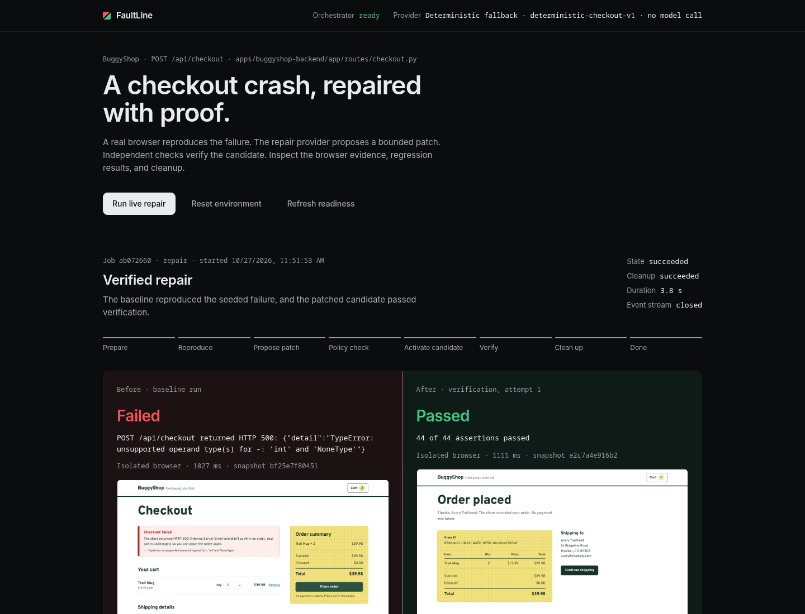

# FaultLine

**A browser finds the checkout failure. A model proposes a patch. Independent checks decide whether it works.**

FaultLine is a controlled source-repair prototype for the Meta Global AI Developer Hackathon. It targets one reproducible Python checkout defect: buying without a coupon produces an HTTP 500. A successful repair must complete the same browser journey and preserve coupon, pricing, validation, and order-storage behavior.

The result is a **verified candidate with downloadable evidence**. FaultLine does not deploy to production, route live traffic, or claim compliance certification.

**Judges: start at the [FaultLine judge page](https://frankiebiz.github.io/Faultline/).** No install is needed:

- **Play the recorded Meta repair.** The retained `muse-spark-1.3` job plays back at its real 13-second timing, from the crashing checkout to 44 passing checks.
- **Break it yourself.** Plant one of ten bugs and watch the model repair it live in the isolated runtime, under the same gates. The model is never told which bug you picked. When the live service is off, the page says so and offers the recording instead.
- **Try to fool the gates.** Browse eleven recorded candidate patches under a naive "did it return 201?" check and under FaultLine.
- **Read the raw record.** [Replays](https://frankiebiz.github.io/Faultline/replay/3573b32b-09bd-4f14-897d-cf6dccf9b118/) open in any browser.



Recorded local workflow evidence; this screenshot does not represent a live Meta trial.

## Run a configured repository

`faultline run [scenario_name]` now executes named scenarios from `faultline.toml` or a CLI-supplied ReproSpec. It freezes tracked source, requires two matching isolated failures, requests a Meta patch for the selected file, verifies the candidate, and emits a checksummed proof after cleanup. The existing Inspector demo retains its checkout-specific regression suite.

```bash
uv run --project services/repair-orchestrator --python 3.13 --locked faultline run checkout_api --detect
uv run --project services/repair-orchestrator --python 3.13 --locked faultline run checkout_api
```

See [project runner configuration and limits](docs/PROJECT_RUNNER.md) for external repositories, browser/HTTP steps, Meta credentials, and proof verification. This is a configurable local single-service runner, not a claim that every website works without setup.

## Run it

Requires Linux with working unprivileged user namespaces and Bubblewrap (`bwrap`), cgroup v2 with a systemd user session (run from a desktop terminal or user service, not a bare SSH login), Git, Python 3.13 via `uv`, and Node.js 24+. On Fedora, if Bubblewrap is missing: `sudo dnf install bubblewrap`. The controller fails closed when its execution requirements, including enforced aggregate resource limits, are unavailable. Use a full `git clone`, not `--depth 1` or a ZIP download: the seeded fixture is pinned to a commit in this repository's history.

```bash
make setup
make check
./scripts/start-demo.sh
```

Open [the Inspector](http://127.0.0.1:4000) and choose **Run the demo**. The launcher binds services to loopback, generates a session control credential if needed, and retains job history. It reports occupied ports instead of killing their owners. Ctrl+C stops its owned processes.

If any default port is taken, choose others and point the rehearsal at the matching Inspector:

```bash
BUGGYSHOP_API_PORT=8400 FAULTLINE_PORT=9400 BUGGYSHOP_PORT=3400 INSPECTOR_PORT=4400 ./scripts/start-demo.sh
FAULTLINE_INSPECTOR_URL=http://127.0.0.1:4400 ./scripts/rehearse-demo.sh
```

On Fedora, `make setup` prints Playwright's "OS is not officially supported" warning and downloads its Ubuntu fallback Chromium build. The fallback works; the warning is harmless.

| Service | URL |
| --- | --- |
| Inspector | http://127.0.0.1:4000 |
| Seeded storefront | http://127.0.0.1:3000 |
| Seeded API | http://127.0.0.1:8000 |
| Controller | http://127.0.0.1:9000 |

To use Meta generation, supply `META_API_KEY` through the server environment or an ignored local `.env`. Optional settings are `META_BASE_URL`, `META_MODEL_NAME` (default `muse-spark-1.3`), `META_REASONING_EFFORT`, `META_RESPONSE_FORMAT`, and `META_TIMEOUT_SECONDS`; see the [orchestrator README](services/repair-orchestrator/README.md#configuration). Never put credentials in browser code. The startup probe reports the actual provider and availability.

Provider identity comes from the endpoint host, not from variable names: only Meta-operated hosts are labeled Meta, loopback endpoints are `local`, and anything else is `openai-compatible`. An attempt is attributed to a provider only when that provider actually returned a response.

Without model credentials, the adapter explicitly identifies itself as `deterministic-checkout-v1`. This is useful for local verification; **it is not a Meta model trial**. Configured provider failures do not silently select that fallback.

```bash
./scripts/rehearse-demo.sh
```

The rehearsal exits unsuccessfully for failed, cancelled, interrupted, timed-out, or unverified jobs. Success requires a reproduced failure, a passing candidate execution, and confirmed cleanup. The live fixture stays seeded so another run can reproduce the same defect.

## What the gates check

1. Reproduce the seeded checkout failure in a fresh real Chromium session.
2. Correlate the HTTP error with observed server failure evidence.
3. Ask the configured provider for a schema-bound, single-file unified diff. The prompt states the checkout's business contract, not the defect or its fix.
4. Reject stale source hashes, wrong paths, malformed hunks, oversized changes, syntax errors, and forbidden imports/capabilities. Catch-all exception handlers are rejected. Limits: 16 KiB diff, 32 KiB source, 100 changed lines. Miscounted hunk headers are recounted from the hunk body, as `git apply --recount` does; content is never altered.
5. Apply the candidate to a fresh detached worktree from the pinned fixture commit. Export application files separately from tests and reference solutions.
6. Execute the candidate inside the restricted runtime: Linux namespaces plus an aggregate cgroup v2 scope (512 MiB, no swap, 64 tasks, one CPU) whose limits are read back from the kernel. Run the browser journey and 27 independent HTTP business assertions, retaining real screenshots, Playwright traces, request logs, and reports.
7. If any gate rejects the first attempt, send its findings (failing checks with expected and observed values, or the policy error) back as untrusted evidence for one more attempt.
8. Verify execution identity and artifact hashes, then confirm resource cleanup before recording a verified result. Cleanup failure quarantines further admission.

Static AST inspection and Git worktrees are policy and source-management tools. The runtime provides process isolation. Passing this bounded suite is evidence for the tested fixture behavior, not a proof that arbitrary code is safe.

## Evaluation

The controller demo covers one registered defect. To test more than that fixture, `./scripts/evaluate.sh` runs the same adapter, patch policy, feedback loop, and oracle over a hash-pinned corpus, executing every variant and candidate in the isolated runtime. [Full method and results](docs/EVALUATION.md).

**What verification catches.** Of six plausible but wrong repairs of the registered defect, a naive check that the failing request now returns HTTP 201 accepted five. FaultLine accepted none, accepted both correct repairs, and rejected three out-of-policy patches before execution.

**Unfamiliar defects.** Nine further single-defect variants (rounding, normalization, pricing, validation, persistence) test repairs the provider was not told about. The deterministic fallback repairs only the registered defect (1 of 10), as expected. To exercise the loop with real model output before Meta credentials were configured, a non-Meta model (DeepSeek `deepseek-v4-pro`, labeled as such in every record) verified 18 of 20 runs over two trials. In two runs the gates rejected its wrong patches. No live Meta evaluation has been run yet; it requires `META_API_KEY`.

These results describe an authored corpus for one checkout route, not arbitrary applications.

## Live repair service

`scripts/start-live-demo.sh` serves the judge page's "Break it yourself" panel. A visitor can choose only one of the ten corpus defects; no code or text is accepted. Each run uses the evaluation loop: a fresh isolated backend with the chosen defect, the 27 business checks, a model proposal under the patch policy, re-measurement, and one retry with the gates' findings. It runs one job at a time, with per-visitor and daily limits. Production requires a Meta provider (`LIVE_DEMO_REQUIRE_PROVIDER=meta`). Every finished run is appended to a public ledger, labeled by the provider that answered. [`deploy/README.md`](deploy/README.md) covers hosting it on a small Linux VM, and `scripts/configure-live-demo.py` points the judge page at it.

## Evidence tools

- `scripts/trial_ledger.py` runs repeated controller jobs and records provider, outcomes, attempts, tokens, latency, assertions, and cleanup together. `--require-provider meta` refuses to record anything else as a Meta trial.
- [Retained Meta repair replay](https://frankiebiz.github.io/Faultline/replay/3573b32b-09bd-4f14-897d-cf6dccf9b118/) ([files](docs/replay/3573b32b-09bd-4f14-897d-cf6dccf9b118)): controller-recorded `muse-spark-1.3` response, failed baseline, 44 passing candidate assertions, and cleanup. [Provenance review](docs/evidence/2026-10-28-meta-replay-review.md) confirms checksums and identifies workstation paths in its trace archives. A [second Meta replay](https://frankiebiz.github.io/Faultline/replay/82ac2dcc-e7f9-4ea7-9187-a0c0d79d8ba3/) records a rejected first proposal and a verified retry.
- `scripts/export_replay.py` exports a finished job as a static, read-only, checksummed replay with no scripts or external requests. A [reviewed example from a deterministic rehearsal](https://frankiebiz.github.io/Faultline/replay/83d1c403-9f6a-4d69-9a46-e39c83ac2471/) is in [`docs/replay/`](docs/replay/83d1c403-9f6a-4d69-9a46-e39c83ac2471); its trace archives are omitted because they contain local file paths.
- Each verified job also stores a checksummed evidence bundle and review summary; `tools/verify_bundle.py` re-checks a bundle and its exported artifacts offline. The digest is a checksum, not a signature.
- `scripts/demo-chaos.sh` is a terminal walkthrough that prints only what it measures in that run: the containment probe, the registered defect repaired under the gates, and wrong repairs rejected.
- Recorded evidence from this review is in [`docs/evidence/`](docs/evidence/).

## Scope and limits

- The default Inspector serves `scripted_checkout_repair`; the CLI and a configured controller accept project ReproSpecs. The authored evaluation corpus still covers ten defects and eleven candidate patches for the checkout route.
- Pricing uses integer cents; coupons are `TENOFF` and `FIFTEEN`.
- Additional chaos scenarios are explicitly authored previews, not live backend defects.
- No continuous production monitoring, Sentry/GitHub integration, rollout, or automatic production deployment.
- No measured customer adoption, revenue saved, recovery SLA, or externally awarded judging score.
- Namespaces plus cgroup limits on a shared kernel, not a VM; no seccomp filter. An internal adversarial review is recorded; external review is still outstanding.
- Local checks, contained browser execution, and live Meta inference are separate verification claims. A retained Meta controller repair passed 44 assertions with successful cleanup; [replay provenance and archive review](docs/evidence/2026-10-28-meta-replay-review.md) describe what was checked. Repeated Meta trials and a Meta corpus evaluation remain outstanding. See [the review](docs/QUALITY_REVIEW.md) for the latest evidence and remaining release work.

## Repository

| Path | Responsibility |
| --- | --- |
| [apps/buggyshop-backend](apps/buggyshop-backend) | Seeded FastAPI fixture and protected business inputs |
| [apps/buggyshop-frontend](apps/buggyshop-frontend) | Accessible storefront and runtime backend proxy |
| [services/repair-orchestrator](services/repair-orchestrator) | Durable admission, model adapter, patch policy, runtime, cleanup |
| [tools/browser-runner](tools/browser-runner) | Trusted Playwright journey, assertions, and evidence |
| [web/inspector-ui](web/inspector-ui) | Readiness, job results, diffs, and evidence inspection |
| [shared](shared) / [fixtures](fixtures) | Canonical contracts, scenario, pinned source provenance, and the evaluation corpus |
| [scripts](scripts) | Dependency setup, supervised startup, reconciliation, rehearsal, evaluation, trial ledger, replay export, live repair service |
| [deploy](deploy) | Runbook and service files for hosting the live repair service |

`make check` runs Python lint/format/type checks and tests, fixture and evaluation-corpus provenance, storefront lint/type/build, runner type/build/unit tests, Inspector type/build, and Python distribution builds. `make browser` runs Inspector and storefront browser regressions; `make integration` requires actual isolated Chromium and cgroup checks; `make evaluate` runs the evaluation. See the service documentation for runtime integration verification.

## Hackathon materials

[Event brief](docs/HACKATHON_BRIEF.md), [project status](docs/PROJECT_STATUS.md), [score assessment](docs/HACKATHON_SCORE_ASSESSMENT.md), [evaluation](docs/EVALUATION.md), [impact evidence](docs/IMPACT_EVIDENCE.md), [submission draft](docs/DEVPOST_SUBMISSION.md), [video storyboard](docs/VIDEO_STORYBOARD.md), [technical dossier](docs/SUBMISSION.md).

The official event pages list submission on November 4, 2026 at 9 PM ET, subject to organizer changes ([Meta](https://dev.meta.ai/events/global-hackathon), [Cerebral Valley](https://events.cerebralvalley.ai/e/meta-ai-developer-hackathon); retrieved October 27, 2026). Preserved webinar materials in `meta-provided/` are immutable.

Built by Francis Bisignano (`FrankieBiz`).
