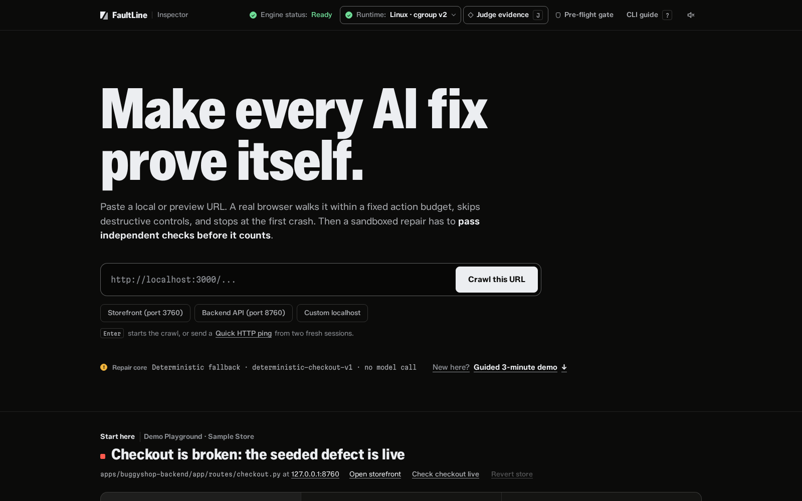

# FaultLine: Sandbox-Verified Repair and a Pre-Flight Gate for Web Applications

**A real browser finds the failure. A Meta model proposes a patch. Independently authored business checks decide whether it works, while a kernel sandbox confines the candidate.**

**Judges: start at the [FaultLine judge page](https://frankiebiz.github.io/Faultline/).** It needs no install: play the recorded Meta repair, plant a bug yourself, and try to fool the gates.

---

## 🧭 Quick Guide for Hackathon Judges: Public vs. Local

| Surface | URL | Audience & Setup | What It Does & How to Judge It |
| :--- | :--- | :--- | :--- |
| **Public Judge Page** *(Recommended First Stop)* | [frankiebiz.github.io/Faultline/](https://frankiebiz.github.io/Faultline/) | **Judges & Evaluators**<br>*(Zero install, works in any browser on desktop/mobile)* | **The Primary Hackathon Showcase:**<br>1. **Recorded Meta repair**: replay one retained `muse-spark-1.3` job that took the checkout crash to 44/44 passing assertions in 13.0 s. The [Oct 31 ledger](docs/evidence/2026-10-31-controller-ledger-meta.md) adds 3 of 3 live trials verified on the first attempt (median 10.5 s, one scenario).<br>2. **Pre-Flight Agent Gate replays**: two recorded `faultline gate --json` verdicts (a blocked run against AuraScale, a scratch app outside this repo, and a clean storefront run from the earlier contract) with the agent fix prompt.<br>3. **Patch explorer**: 11 candidate patches show a naive status check accepting 5 of 6 wrong fixes, while FaultLine's authored business assertions reject all six.<br>4. **Static evidence replays**: SHA-256 checksummed, script-free records. |
| **Local Inspector Studio** | `http://127.0.0.1:4000`<br>*(via `./faultline demo`)* | **Engineers & SREs**<br>*(Requires Linux for sandbox repairs; Pre-Flight Gate runs cross-platform on macOS/Linux/Windows)* | **Local execution:**<br>1. A headless Playwright crawler with deterministic heuristics explores a `localhost` app (the bundled store on `:3000`, or any URL you paste).<br>2. Talks to the local repair orchestrator (`:9000`), which calls the Meta Model API when a key is set and otherwise uses the labeled deterministic fallback.<br>3. Runs candidate diffs inside Bubblewrap namespaces under 512 MiB / 64 task / 1 CPU cgroup limits.<br>4. Applies a verified fix only to the bundled demo store; project repairs stay in the sandbox and never touch your working source. |
| **Demo Target Store** | `http://127.0.0.1:3000`<br>*(API: `:8000`)* | **Local Test Target**<br>*(Part of `./faultline demo`)* | **BuggyShop E-Commerce App:** A real Next.js + FastAPI shop with a seeded coupon discount exception on checkout that triggers HTTP 500. |
| **AuraScale Cloud** *(historical, not in this repo)* | was `http://127.0.0.1:5050` | **External scratch app**<br>*(Not shipped or needed)* | Used once on November 1 for the recorded blocked-gate replay on the judge page. Nothing here starts it, and no filming or test depends on it. |

### ⏱️ The 3-Minute Judging Tour

If you have 3 minutes to evaluate FaultLine, follow this sequence on the **[Public Judge Page](https://frankiebiz.github.io/Faultline/)**:

1. **Watch the recorded Meta repair (top of the page)**:
   Click **Play the recorded Meta repair**. The retained job replays at its recorded timing (13.0 s): the checkout rupture, Meta's `muse-spark-1.3` single-file diff, the policy check, the sandboxed run, and 44 authored checks turning green. Nothing is merged or deployed.
2. **Replay the Pre-Flight Agent Gate (section 01)**:
   Click **Test Broken Site**. The recorded verdict is `DEPLOYMENT_BLOCKED` with the click-by-click reproduction trail and the fix prompt an agent would receive. **Test Clean Site** replays a pass recorded under the earlier contract, before the gate reported whether exploration finished; it is captioned as such.
3. **Try to fool the gates (section 05)**:
   Pick wrong patches from the authored corpus. A naive "returns HTTP 201" check accepts 5 of 6; FaultLine's business assertions reject all six. The sandbox confines each run; the assertions are what catch the regression.

---

## The 2 AM checkout failure

It's 2 AM. A shopper fills a cart, skips the coupon field, and clicks **Place order**. The API answers with **HTTP 500**. Nobody is paged, because the homepage is up and the error rate barely moves. Every customer who checks out without a coupon gets the same crash until someone notices in the morning, and each one is a lost order.

FaultLine is built for that kind of bug: a reproducible business failure in code you own. It:

1. reproduces the failure in a real Chromium session,
2. asks Meta's `muse-spark-1.3` for a single-file unified diff,
3. rejects unsafe or out-of-scope patches before they run,
4. executes the candidate inside a Bubblewrap sandbox under kernel-enforced cgroup v2 limits,
5. replays the same browser journey plus independent business assertions, and
6. emits a checksummed evidence bundle.

The output is a **verified candidate with proof**, never a silent production change. FaultLine does not deploy, route live traffic, or claim compliance certification. The developer reviews and applies the fix.

### Why a local developer tool, not a cloud SaaS wrapper

| Concern | Remote SaaS repair bot | FaultLine (local CLI + Inspector) |
| --- | --- | --- |
| Source custody | The whole repository is uploaded to a vendor | The repository stays on your machine. The only outbound data is the bounded model request: one target file plus failing-check evidence, marked as untrusted. The deterministic demo fallback sends nothing. |
| Reaching your app | Needs tunnels or a deployed preview | Talks directly to `localhost` dev servers (Next.js, Vite, Express, FastAPI) |
| Running untrusted patches | Opaque vendor container | Bubblewrap user, PID, IPC, network, UTS, and mount namespaces; read-only code mounts; a cgroup v2 scope whose limits are read back from `/sys/fs/cgroup` before anything runs |
| Proof | A chat message saying "fixed" | Screenshots, Playwright traces, request logs, assertion reports, and a checksummed bundle you can re-verify offline |

---

## What judges can do on the hosted page

The [judge page](https://frankiebiz.github.io/Faultline/) is static and works without cloning anything:

- **Play the recorded Meta repair.** A retained `muse-spark-1.3` controller job replays at its recorded timing (13.0 s for that job), from the crashing checkout to 44 of 44 passing checks. The Oct 31 ledger's three live trials took 10.4 to 12.6 s.
- **Break it yourself.** Plant one of ten corpus bugs and watch the model repair it live in the isolated runtime, under the same gates. The model is never told which bug you picked. When the live service is offline, the page says so and offers the recording instead.
- **Try to fool the gates.** Compare eleven recorded candidate patches under a naive "did it return 201?" check and under FaultLine.
- **Read the raw record.** The [replays](https://frankiebiz.github.io/Faultline/replay/3573b32b-09bd-4f14-897d-cf6dccf9b118/) are static, script-free, and checksummed.



*Recorded local workflow evidence. This screenshot shows the deterministic fallback, not a live Meta trial.*

---

## Installation and quickstart

### Prerequisites

| Requirement | Notes |
| --- | --- |
| macOS, Windows, or Linux | Pre-Flight Gate (`gate`, `check`, `test`, `scan --no-repair`, `init`) runs natively. Sandboxed repair execution requires Linux. **WSL2 is untested** and needs systemd enabled (`systemd=true` in `/etc/wsl.conf`) and cgroup v2. |
| Node.js and npm | Install Node.js 24+ (recommended) before setup. The locked dependencies also support Node 20.19+ and 22.13+. Setup explains missing or unsupported versions. |
| [`uv`](https://docs.astral.sh/uv/) and Python 3.13 | Setup discovers an existing uv or installs it using [Astral's official installer](https://docs.astral.sh/uv/getting-started/installation/), then downloads standalone Python 3.13. No system Python installation is needed. |
| Git; curl on macOS/Linux; PowerShell on Windows | Use a **full clone**, not `--depth 1` or a ZIP. The seeded fixture is pinned to a commit in this repository's history. macOS does not need GNU `readlink` or `setsid`. |
| Linux repair only: Bubblewrap (`bwrap`) | Unprivileged user namespaces must work. Fedora: `sudo dnf install bubblewrap`. |
| Linux repair only: cgroup v2 + systemd user session | Run from a desktop terminal or a user service, so `systemd-run --user` can create a delegated scope. |

FaultLine **fails closed**. If namespaces or enforced aggregate resource limits are unavailable, it refuses to run candidates instead of running them unconfined.

### 1. Clone and set up (macOS / Linux)

```bash
git clone https://github.com/FrankieBiz/Faultline.git
cd Faultline
make setup
```

You can also run `bash scripts/setup.sh` if `make` is unavailable. Setup finds uv in PATH or standard local/Homebrew directories, installs it if missing, installs Python 3.13, syncs both locked Python environments, runs `npm ci` for the storefront, runner, and Inspector, builds the browser runner, and installs Playwright Chromium. On Fedora, Playwright prints an "OS is not officially supported" warning and downloads its Ubuntu fallback Chromium.

On a Mac, start with native checks against your running application:

```bash
./faultline doctor
./faultline test http://localhost:3000
./faultline scan http://localhost:3000 --no-repair
./faultline gate http://localhost:3000 --json
```

`./faultline demo` starts the local demo services on macOS/Linux. macOS can explore the seeded bug and use the Inspector; candidate repair remains unavailable without Linux isolation. The hosted [judge page](https://frankiebiz.github.io/Faultline/) also replays the retained repair without local setup.

### Windows quickstart (PowerShell or Command Prompt)

Install Git and Node.js 24+ with npm, then open PowerShell:

```powershell
git clone https://github.com/FrankieBiz/Faultline.git
cd Faultline
.\setup.bat
.\faultline.cmd doctor
# Start your application separately, then check it:
.\faultline.cmd test http://localhost:3000
.\faultline.cmd scan http://localhost:3000 --no-repair
.\faultline.cmd gate http://localhost:3000 --json
```

The `.bat` / `.cmd` wrappers also work in Command Prompt and require no Make, Bash, or preinstalled Python. To invoke PowerShell scripts directly where script execution is restricted:

```powershell
powershell -NoProfile -ExecutionPolicy Bypass -File .\setup.ps1
powershell -NoProfile -ExecutionPolicy Bypass -File .\faultline.ps1 doctor
```

Setup uses Astral's official PowerShell uv installer when needed and installs the same Python, locked dependencies, and Chromium as the Unix setup. The CLI launchers preserve your current directory, so you can initialize another project without copying FaultLine into it:

```powershell
$faultline = (Resolve-Path .\faultline.cmd).Path
cd C:\code\my-app
& $faultline init
& $faultline check --config faultline.toml --port 3000
```

Native Windows supports pre-flight commands; the local demo launcher and sandboxed repairs require Linux/WSL2. Use the hosted judge page for the recorded repair, or run the Linux quickstart inside a suitably configured WSL2 distribution. WSL2 isolation has not been verified by this project.

### 2. Check system health

```bash
./faultline doctor
```

`doctor` reports your platform, uv, Node.js, Playwright Chromium, optional `META_API_KEY`, and whether the controller and storefront API are reachable. On macOS/Windows, optional inference and offline demo services do not block a healthy pre-flight installation. Linux also checks Bubblewrap, cgroup v2, and systemd. Finding the tools only means the prerequisites exist. The isolation guarantee comes from the runner's own enforcement preflight, which runs before every candidate launch.

### 3. Launch the demo stack

```bash
./faultline demo
```

This opens the **Inspector at <http://127.0.0.1:4000>**. If the complete demo is
already healthy, it prints `FaultLine demo stack is already active` and connects.
Otherwise it runs the existing `scripts/start-demo.sh` launcher in the foreground;
Ctrl+C stops that session. Use `--no-open` to print the URL without opening a browser,
or `--restart` to restart a demo owned by this installation's identifiable launcher.
Foreign services, partial stacks without `--restart`, and restarts of other worktrees
are refused. Other-port stacks are preserved; use a separate worktree if one is
already using this installation's build files. Concurrent `faultline demo` launches
fail cleanly while another launch or restart is in progress.

| Service | URL |
| --- | --- |
| Inspector (web studio) | http://127.0.0.1:4000 |
| Seeded storefront | http://127.0.0.1:3000 |
| Seeded checkout API | http://127.0.0.1:8000 |
| Repair controller | http://127.0.0.1:9000 |

The launcher binds every service to loopback, generates a session control credential if needed, and keeps job history. If a port is taken, it reports the owner instead of killing it. Ctrl+C stops only the processes it started. To use other ports:

```bash
BUGGYSHOP_API_PORT=8400 FAULTLINE_PORT=9400 BUGGYSHOP_PORT=3400 INSPECTOR_PORT=4400 ./faultline demo
FAULTLINE_INSPECTOR_URL=http://127.0.0.1:4400 ./scripts/rehearse-demo.sh
```

`./scripts/rehearse-demo.sh` drives a full run headlessly. It exits non-zero for failed, cancelled, interrupted, timed-out, or unverified jobs.

### 4. Install the CLI globally

The root `faultline` launcher resolves its own installation through symlinks and keeps your working directory, so one checkout can serve every project:

```bash
mkdir -p ~/.local/bin
ln -sf "$(pwd)/faultline" ~/.local/bin/faultline
```

To test any running HTTP service without project configuration:

```bash
faultline test http://localhost:3000
faultline test http://localhost:8000/healthz --method GET --status 200 --json
```

The command sends the request in two fresh sessions, without a request body or
redirect following. Both must match the expected status to pass. Non-GET requests
also run twice and may change the target's state. Exit codes are **0** for pass,
**1** for failure (including flaky or unreachable), **2** for invalid input, and
**130** for interruption. `--json` emits one result with the actual session count;
transport errors can stop after the first session. This checks HTTP behavior and
does not perform repairs or require sandbox prerequisites.

To hunt for a defect without stating any expectation, paste a URL:

```bash
faultline scan http://127.0.0.1:3000      # alias: faultline auto
```

```text
[Playwright] Navigating to http://127.0.0.1:3000/...
[Playwright] Discovered 9 interactive elements across 1 screen.
[Playwright] Exercising buttons and forms...
[Playwright] Step 2: Clicking Trail Mug -> OK
[Playwright] Discovered 17 interactive elements across 2 screens.
[Playwright] Step 3: Clicking Add to cart -> OK
[Playwright] Step 4: Clicking Go to checkout -> OK
[Playwright] Discovered 30 interactive elements across 3 screens.
[Playwright] Step 5: Filling Name with "Alex Tester" -> OK
[Playwright] Step 6: Filling Email with "test@example.com" -> OK
[Playwright] Step 7: Filling Address with "123 Main St" -> OK
[Playwright] Step 8: Clicking Place order -> FAILED
[Playwright] 💥 BUG CAUGHT: HTTP 500 on POST /api/checkout
```

The scan prints the evidence and the numbered reproduction journey, then asks
`Defect intercepted! Propose and verify patch with Meta in sandbox? [Y/n]`. On yes
it starts the sandbox run for the scenario covering that route on the running
engine (`--port`, default `$FAULTLINE_PORT` or 9000) and streams it with the
`listen` HUD. The prompt names Meta only when readiness reports the Meta provider;
otherwise it names the fallback or offers detection only. `--yes` dispatches
without asking (required when stdin is not a terminal), and `--no-repair` only
reports. Defects with no covering scenario, page errors, and an unreachable engine
are explained instead of dispatched. Defaults are 25 actions and 90 seconds.

`faultline crawl URL` (alias `break`) runs the same crawl without the repair offer.
Headless Chromium discovers links, buttons, script-driven product cards, and forms
on the same origin. When a screen has nothing left to try, it opens the most
promising unvisited screen it has seen linked (cart and checkout first). It fills
required fields with realistic values chosen from `autocomplete` tokens and field
names (`Alex Tester`, `test@example.com`, `123 Main St`, `62704`, `555-010-0199`, a
quantity of 2 within the field's limits, the first choice of a required radio
group), leaves optional ones such as coupon boxes empty, and clicks in
shopping-funnel order. It skips destructive controls like Remove or Log out. The first action that triggers
an HTTP 5xx, a 400/422 on a fetch or page load, an uncaught page error, or a
`console.error` stops the crawl. The report gives the endpoint, response body,
stack, and the breadcrumb selectors that reproduce the failure. Against the seeded
store it stops at **Place order** with `HTTP 500 on POST /api/checkout`. Exit codes
are **0** clean (after `--max-actions`, default 15, or nothing left to try), **1**
defect found or crawl failure, and **2** invalid input. `--json` prints only the
report. The orchestrator exposes the same crawl as an authenticated
`POST /api/crawl` with body `{"url": "...", "max_actions": 15}`. Its reply adds
structured telemetry to the report: `elements_explored`, `screens_visited` (path,
title, element and form counts, the step that reached it), `actions` (each
interaction with `ok`), `failure` (null when clean), and `reproduction_trail`
(numbered plain-language steps with selectors), plus `stop_reason`
(`exhausted`, `max_actions`, or `timeout`) for a crawl that found nothing. Only
`exhausted` means exploration finished; the gate and the Inspector treat the
others as inconclusive. The Inspector's **Run Autonomous Exploration** button
streams it live through `POST /api/faultline/crawl`, whose closing `done` event
carries the same telemetry.

Then, inside any Next.js, Vite, Express, or FastAPI repository:

```bash
cd ~/code/my-app
faultline init                                             # detect the stack, write a reviewable faultline.toml
# start your dev server, then gate it on its declared HTTP invariants:
faultline check --config faultline.toml --port 3000
faultline check --config faultline.toml --port 3000 --json  # one JSON object on stdout, for CI
```

`init` detects Next.js App/Pages routers, Vite (React/Vue/Svelte), Express and generic Node entrypoints, FastAPI/Starlette, Flask, and Django. It writes a starting invariant for you to review; it doesn't guess a repair target. The sandbox currently mounts Node/npm and uv only, so adapt pnpm, Yarn, or Bun commands to installed Node entrypoints before requesting repair. See [CLI checks, initialization, and CI](docs/CLI_CHECK.md) and [the project runner](docs/PROJECT_RUNNER.md).

### 5. Connect Meta (optional)

```bash
export META_API_KEY=...        # or put it in an ignored .env at the repo root
./scripts/start-demo.sh
```

Optional settings are `META_BASE_URL`, `META_MODEL_NAME` (default `muse-spark-1.3`), `META_REASONING_EFFORT`, `META_RESPONSE_FORMAT`, and `META_TIMEOUT_SECONDS`. See the [orchestrator README](services/repair-orchestrator/README.md#configuration). Credentials stay server-side and never reach browser code or the candidate sandbox.

- **Without a key**, the checkout demo uses a clearly labeled **deterministic fallback**, `deterministic-checkout-v1`. It exercises the full pipeline locally, but **it is not a Meta model trial**, and every record says so.
- **A configured provider that fails** never silently falls back to the deterministic adapter.
- **Project repairs** (`faultline run`, `faultline check --repair`) require a Meta provider and have no fallback.
- **Provider identity comes from the endpoint host**, not from variable names. Only Meta-operated hosts are labeled `meta`, loopback endpoints are `local`, and anything else is `openai-compatible`.

---

## How it works: the 6-step verification engine

**1. Headless browser reproduction.** A fresh, real Chromium session drives the storefront journey through Playwright. The engine intercepts the failing HTTP response and correlates it with observed server failure evidence (for the demo, the 500 and the backend `TypeError` traceback from the allowlisted file). Project scenarios must fail identically in **two** fresh sessions before any model is called, so flaky failures never trigger a repair.

**2. Prompt containment and Meta model repair.** The adapter separates trusted scope from bounded, JSON-encoded **untrusted evidence** (source, logs, findings), and tells the model that instructions inside that evidence are data. The prompt states the checkout's *business contract*, not the defect or its fix. `muse-spark-1.3` returns a schema-bound, single-file unified diff.

**3. AST safety and patch policy.** Before anything runs, the candidate must pass a strict gate:

- Stale source hashes, wrong or extra paths, malformed hunks, and NUL bytes are rejected.
- Size limits: 16 KiB diff, 32 KiB source, 100 changed lines.
- The patched file is parsed (never executed) and rejected for invalid syntax, any bare `import`, `from` imports outside the approved symbol allowlist, dynamic execution or OS capabilities, dunder access, and **catch-all exception handlers** (`except:`, `except Exception`) that would hide the failure instead of fixing it.
- Hunk headers with miscounted line totals are recounted from the hunk body, as `git apply --recount` does. Content is never altered.

**4. Hermetic Bubblewrap sandboxing.** The candidate is applied to a fresh detached worktree from the pinned fixture commit, with application files exported separately from tests and reference solutions. It then runs under `bwrap --unshare-all --unshare-user --die-with-parent --new-session --clearenv --cap-drop ALL`, which gives it private user, PID, IPC, network, UTS, and mount namespaces. The source snapshot, interpreter, and dependencies are mounted read-only, `/tmp` and `/run` are small tmpfs mounts, and the environment is emptied.

**5. Kernel-enforced cgroup v2 limits.** Every candidate launch runs in a `systemd-run` scope with **512 MiB memory, no swap, 64 tasks, and one CPU**. Before execution, the runtime reads `memory.max`, `memory.swap.max`, `pids.max`, and `cpu.max` back from `/sys/fs/cgroup` and refuses to proceed if they don't match. Then the browser journey and **27 independent HTTP business assertions** run against the candidate, keeping real screenshots, Playwright traces, request logs, and reports.

**6. Verifier-guided feedback loop and checksummed proof.** If any gate rejects attempt 1, its structured findings (failing check IDs with expected and observed values, or the exact policy error) go back to the model as untrusted evidence for **a second round**. A job is `verified` only after the controller has confirmed execution identity, artifact hashes, and resource cleanup. If cleanup fails, new jobs are refused until it is resolved. Each verified job stores a checksummed evidence bundle that `tools/verify_bundle.py` re-checks offline. The digest is a checksum, not a signature.

Static AST inspection and Git worktrees are policy and source-management tools; process isolation comes from the runtime. Passing this bounded suite is evidence for the tested behavior, not proof that arbitrary code is safe.

---

## Three ways to use FaultLine

### Terminal power users

| Command | What it does |
| --- | --- |
| `faultline init` | Detects the stack and writes a reviewable `faultline.toml` |
| `faultline check` | Gates a running service on declared HTTP invariants, each measured in two fresh sessions; `--repair` asks for a sandbox-verified candidate without touching source |
| `faultline scan URL` | Paste a URL: explores same-origin screens within an action and time budget, fills forms, catches the first defect, prints its reproduction journey, and offers to propose and verify a patch in the sandbox; alias `faultline auto` |
| `faultline crawl URL` | Clicks through a site in headless Chromium until something breaks, then prints the failure and its reproduction breadcrumbs; alias `faultline break` |
| `faultline gate URL` | Pre-deployment smoke gate for coding agents and CI: the same crawl, one verdict (`SAFE_TO_DEPLOY` exit 0 only when exploration finished with no defect; `DEPLOYMENT_BLOCKED` exit 1 for a defect or an unfinished crawl; bad input exit 2) with `--json`, `--markdown`, or `--format agent\|ci`, plus a ready-to-paste agent fix prompt |
| `faultline doctor` | Checks sandbox prerequisites, the Meta key, and service health |
| `faultline run [scenario]` | Freezes tracked source, needs two matching isolated failures, requests a Meta patch, verifies it, and writes a checksummed proof to `.faultline/runs`; `--detect` stops before the model call |
| `faultline listen [job]` | Streams a job's stages as a live HUD with a cyan spinner and progress bar for in-flight work; `--plain` gives one line per stage for CI logs |
| `faultline dashboard` | Opens the Inspector, starting the built app if nothing is serving it |

`status`, `jobs`, `diff`, `apply`, `revert`, `verify`, and `version` round out the CLI. Every command honors `NO_COLOR`, `--no-color`, `--plain`, and non-TTY output, and `--port` / `--api-port` follow `FAULTLINE_PORT` / `BUGGYSHOP_API_PORT`.

### Web Inspector studio (`localhost:4000`)

- **1-2-3 guided demo.** The Demo Playground (sample store) runs **Break it** (the Playwright chaos crawler clicks through the store until checkout returns HTTP 500), the sandbox repair (labeled **Repair with Meta** only when the engine reports the Meta Model API), and **Apply fix** (hot-patch, then a live check confirms HTTP 201). Each step advances on recorded evidence, not clicks.
- **Paste and go.** The hero arena at the top takes any URL (or a Storefront / Backend API / Custom Localhost preset); nothing asks for an expected status or error. **Run Autonomous Exploration** (or Enter) streams a chaos crawl (`POST /api/faultline/crawl`) into the Live Agent Mission HUD: agent status, screens explored, actions, and defects; a step ticker of the crawler's real actions; then the intercepted failing request with its click trail and a one-click sandbox repair that carries on to the verified assertion count and **Apply Verified Fix to Demo Store** (bundled store only). Until the engine serves a crawler endpoint, a real two-session HTTP check stands in and the HUD labels it as such. **Quick HTTP Ping** sends a GET from two fresh sessions. Bare `localhost:3000/path` means http.
- **Scenario rail.** Repairable defects, project checks from `faultline.toml`, and your saved URLs, each with a status line: cyan while work is in flight, emerald only for evidence-verified repairs, red for failures.
- **Live invariant tester.** Runs `[[invariants.rule]]` and `[scenarios.*]` from `faultline.toml` against the running store, in two sessions each.
- **Custom URL check dialog.** Any method, JSON body, and expected status, validated in place.
- **Procedural Web Audio cues.** Synthesized from oscillators, off by default: an alarm for a failing check and a resolution chord for a verified repair.
- **One-click apply / revert.** **Apply fix** writes a verified, cleanly cleaned-up candidate to the running store's source and re-checks checkout once the store reloads. **Revert store** restores the seeded defect.
- A built-in CLI guide (press `?`) pairs each dashboard control with its terminal command.

### CI/CD pull request gate

[`.github/workflows/faultline-ci.yml`](.github/workflows/faultline-ci.yml) starts a local service on a GitHub runner and runs `faultline check` against it. A passing invariant must exit 0, and a deliberately false one must exit 1. Copy the pattern into your own repository to block pull requests that break declared HTTP contracts. The hosted runner installs the sandbox prerequisites but makes no sandbox-execution claim and does not request repair.

### Pre-Flight Agent Gate

`faultline gate http://127.0.0.1:3000 --json` turns the crawler into a deployment gate that coding agents (Claude, Codex, Cursor, Devin) and pipelines can obey: exit 1 is `DEPLOYMENT_BLOCKED` with the reproduction trail and an `agent_remediation_prompt` the agent can act on, and also covers a crawl that ran out of actions or time before it finished (`error.code: "incomplete_crawl"`, `failure: null`). Exit 0 is `SAFE_TO_DEPLOY` only when the crawl finished exploring (`stop_reason: "exhausted"`) with no defect. That is a bounded smoke signal for the flows the crawler reached, not proof of business correctness; keep declared checks (`faultline check`) for prices, totals, and orders. [`docs/PREFLIGHT_GATE.md`](docs/PREFLIGHT_GATE.md) covers the contract, the agent skill ([`.agents/skills/faultline-gate`](.agents/skills/faultline-gate/SKILL.md)), the drop-in [`.github/workflows/faultline-gate.yml`](.github/workflows/faultline-gate.yml) that writes the verdict to the job summary, and the optional [`.githooks/pre-push`](.githooks/pre-push) hook. The Inspector's Pre-Flight Gate panel runs the same check from the browser and shows the same verdict and fix prompt, with the agent rule, workflow, and skill ready to copy. The [judge page](https://frankiebiz.github.io/Faultline/#gate) replays two verdicts recorded before `stop_reason` was reported; the clean one is captioned as historical.

---

## Evidence and evaluation

### Live Meta trial series: 3 of 3 verified

[`docs/evidence/2026-10-31-controller-ledger-meta.md`](docs/evidence/2026-10-31-controller-ledger-meta.md) was recorded by `scripts/trial_ledger.py --require-provider meta`, which refuses to record anything except a Meta provider response as a Meta trial.

| Trial | Outcome | Attempts | Wall time | Assertions | Cleanup |
| ---: | --- | ---: | ---: | --- | --- |
| 1 | verified | 1 | 10.5 s | 44/44 | succeeded |
| 2 | verified | 1 | 12.6 s | 44/44 | succeeded |
| 3 | verified | 1 | 10.4 s | 44/44 | succeeded |

That is **3 of 3 verified on the first attempt**, with a median wall time of **10.5 s**, no policy rejections, and cleanup confirmed every time. The provider is `meta` and the model is `muse-spark-1.3`. Scope: one registered scenario (`scripted_checkout_repair`).

The retained [Meta repair replay](https://frankiebiz.github.io/Faultline/replay/3573b32b-09bd-4f14-897d-cf6dccf9b118/) ([files](docs/replay/3573b32b-09bd-4f14-897d-cf6dccf9b118), [provenance review](docs/evidence/2026-10-28-meta-replay-review.md)) shows the failed baseline, 44 passing assertions, and cleanup. A [second Meta replay](https://frankiebiz.github.io/Faultline/replay/82ac2dcc-e7f9-4ea7-9187-a0c0d79d8ba3/) records a rejected first proposal and a verified second-round retry. That first proposal was rejected because its diff did not apply cleanly, not because the verifier caught wrong behavior; a behavioral rejection followed by a Meta retry has not been recorded.

### 10-defect evaluation corpus

`./scripts/evaluate.sh` runs the same adapter, policy, feedback loop, and oracle over a hash-pinned corpus in [`fixtures/evaluation/`](fixtures/evaluation). Every variant and candidate runs in the isolated runtime. See the [full method and results](docs/EVALUATION.md).

- **What verification catches.** Of six plausible but wrong repairs, a naive "returns HTTP 201" check accepted five. FaultLine accepted **none**, accepted both correct repairs, and rejected all three out-of-policy patches before execution.
- **Unfamiliar defects.** The registered defect plus nine holdout variants cover rounding, normalization, pricing, validation, and persistence, and the model is never told which defect is present. The deterministic fallback repairs only the registered defect (1 of 10), as designed. A non-Meta model (DeepSeek `deepseek-v4-pro`, labeled as such in every record) verified 18 of 20 runs, and the gates rejected its wrong patches in the other two. **A Meta run over the full corpus has not been recorded yet.**

These results describe an authored corpus for one checkout route, not arbitrary applications.

### Test scorecard

| Suite | Tests |
| --- | ---: |
| Backend, scripts, and fixtures (pytest) | 290 |
| Repair orchestrator and CLI (pytest) | 877 |
| Browser runner unit tests | 123 |
| **Unit and integration total** (`make check`) | **1,290** |
| Inspector browser tests (Playwright) | 43 |
| Storefront browser tests (Playwright) | 2 |
| **Browser total** (`make browser`) | **45** |
| **All automated tests** | **1,335** |

`make check` also runs Ruff lint and format checks, strict mypy, fixture and corpus provenance, the storefront, runner, and Inspector builds, and both Python distribution builds. `make integration` exercises real isolated Chromium and cgroup enforcement, and `make evaluate` runs the corpus.

---

## Live repair service

`scripts/start-live-demo.sh` powers the judge page's **Break it yourself** panel. A visitor can only choose one of the ten corpus defects; no code or text is accepted. Each run gets a fresh isolated backend, the 27 business checks, a model proposal under the patch policy, re-measurement, and one feedback retry. The service runs one job at a time, enforces per-visitor and daily limits, and requires a Meta provider in production (`LIVE_DEMO_REQUIRE_PROVIDER=meta`). Every finished run is appended to a public ledger, labeled by the provider that answered. [`deploy/README.md`](deploy/README.md) covers hosting it on a small Linux VM.

## Evidence tools

- `scripts/trial_ledger.py` records provider, outcomes, attempts, tokens, latency, assertions, and cleanup for repeated controller jobs.
- `scripts/export_replay.py` exports a finished job as a static, read-only, checksummed replay with no scripts or external requests.
- `tools/verify_bundle.py` re-checks an evidence bundle and its exported artifacts offline.
- `scripts/demo-chaos.sh` is a terminal walkthrough that prints only what it measures in that run.
- Recorded evidence lives in [`docs/evidence/`](docs/evidence/).

## Scope and limits

- Sandbox repair binds only to registered scenarios and configured project scenarios. Live checks work against any URL, but a failure outside a repairable scenario is reported as detection only.
- The authored corpus covers ten defects and eleven candidate patches for one checkout route. Pricing uses integer cents; coupons are `TENOFF` and `FIFTEEN`.
- There is no continuous production monitoring, Sentry or GitHub issue integration, rollout, or automatic production deployment.
- There are no measured customer adoption figures, revenue recovered, recovery SLA, or external judging score.
- Isolation is namespaces plus cgroup limits on a shared kernel, not a VM, and there is no seccomp filter. An internal adversarial review is recorded; an external review is still outstanding.
- Local checks, contained browser execution, and live Meta inference are separate verification claims. See the [quality review](docs/QUALITY_REVIEW.md) for current evidence and remaining work.

## Repository map

| Path | Responsibility |
| --- | --- |
| [apps/buggyshop-backend](apps/buggyshop-backend) | Seeded FastAPI fixture and protected business inputs |
| [apps/buggyshop-frontend](apps/buggyshop-frontend) | Accessible storefront and runtime backend proxy |
| [services/repair-orchestrator](services/repair-orchestrator) | CLI, durable admission, model adapter, patch policy, runtime, cleanup |
| [tools/browser-runner](tools/browser-runner) | Trusted Playwright journey, assertions, and evidence |
| [web/inspector-ui](web/inspector-ui) | Inspector studio: scenarios, live checks, job results, diffs, evidence |
| [shared](shared) / [fixtures](fixtures) | Canonical contracts, scenarios, pinned source provenance, evaluation corpus |
| [scripts](scripts) | Setup, supervised startup, rehearsal, evaluation, trial ledger, replay export, live repair service |
| [deploy](deploy) | Runbook and service files for the live repair service |

## Hackathon materials

[Event brief](docs/HACKATHON_BRIEF.md), [project status](docs/PROJECT_STATUS.md), [score assessment](docs/HACKATHON_SCORE_ASSESSMENT.md), [evaluation](docs/EVALUATION.md), [impact evidence](docs/IMPACT_EVIDENCE.md), [submission draft](docs/DEVPOST_SUBMISSION.md), [video storyboard](docs/VIDEO_STORYBOARD.md), [technical dossier](docs/SUBMISSION.md).

The official event pages list submission on November 4, 2026 at 9 PM ET, subject to organizer changes ([Meta](https://dev.meta.ai/events/global-hackathon), [Cerebral Valley](https://events.cerebralvalley.ai/e/meta-ai-developer-hackathon); retrieved October 27, 2026). Preserved webinar materials in `meta-provided/` are immutable.

Built by Francis Bisignano (`FrankieBiz`) for the Meta Global AI Developer Hackathon.
