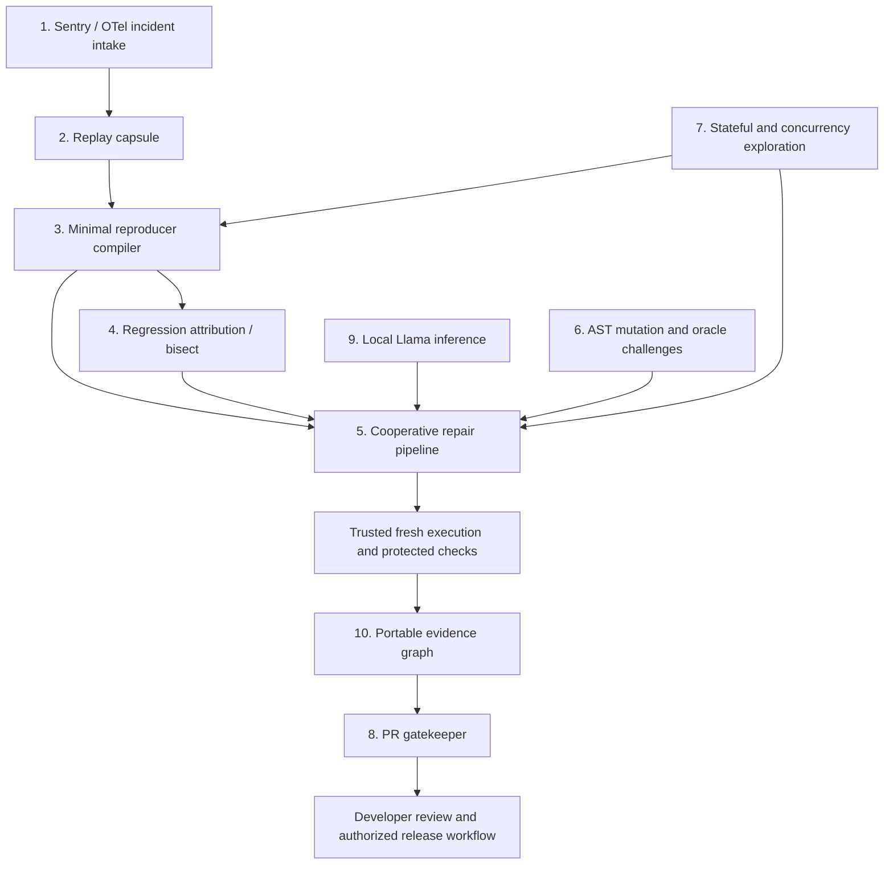

# FaultLine frontier feature proposal

**Date:** November 2, 2026

**Repository baseline:** `45dd0fb` (application code unchanged from `23ea6f6`)

**Scope:** Ten proposed capabilities for autonomous bug reproduction, verification, and repair. This is an architecture and investment proposal, not an implementation or a claim of measured performance. Numerical acceptance targets and effort estimates below are proposed experiment gates.

## Architectural thesis

FaultLine can become the execution and evidence platform through which any bug report, coding agent, or proposed patch must pass. Its durable advantage should be the ability to turn an observed incident into a repeatable experiment, challenge a repair with independent behavioral checks, and deliver evidence another engineer can inspect and rerun.

The next frontier is **causal repair**: establish which inputs, environment, state transitions, and code changes are sufficient to trigger a failure; intervene on those variables; and demonstrate what the repair actually changes. A better patch prompt alone cannot provide this capability.

The ten features form a connected system:

The defining product experience is: select an incident, inspect its smallest reproducer and likely introducing change, compare repair candidates, and obtain a patch whose evidence is bound to the exact source, environment, assertions, and execution conditions.

## What exists today, and what must change

This proposal builds on current code rather than the older snapshot in [LONG_TERM_RESEARCH_AND_IDEAS.md](../LONG_TERM_RESEARCH_AND_IDEAS.md). That document remains useful research; this report narrows the investment into ten implementable systems.

| Existing foundation | Evidence in this checkout | Architectural consequence |
| --- | --- | --- |
| Durable Python controller and strict Pydantic contracts | [worker.py](../../services/repair-orchestrator/app/worker.py), [database.py](../../services/repair-orchestrator/app/database.py), [models.py](../../shared/contracts/models.py) | Extend typed jobs and persisted events; do not introduce a second controller for integrations. |
| Configurable local project execution | [PROJECT_RUNNER.md](../PROJECT_RUNNER.md), [project.py](../../services/repair-orchestrator/app/project.py), [project_runtime.py](../../services/repair-orchestrator/app/project_runtime.py) | Start with configured projects and installed dependencies. Arbitrary production environments require additional adapters. |
| Versioned ReproSpec with eight browser/HTTP primitives and two matching failing baselines | [repro.py](../../services/repair-orchestrator/app/repro.py) | Compile telemetry and discoveries into this contract before inference. Keep a deterministic verification path. |
| Single-target repair policy | [policy.py](../../services/repair-orchestrator/app/policy.py), [project.py](../../services/repair-orchestrator/app/project.py) | Current project limits are one existing file, 32 KiB source, 16 KiB diff, 100 changed lines, and at most two attempts. Broader repair needs a versioned policy. |
| Linux namespaces and verified aggregate cgroup limits | [isolated_runtime.py](../../services/repair-orchestrator/app/isolated_runtime.py), [project_runtime.py](../../services/repair-orchestrator/app/project_runtime.py) | Preserve containment, empty candidate credentials, supervision, cancellation, and confirmed cleanup. A worktree is source isolation, not process isolation. |
| Singleton runtime lease | [database.py](../../services/repair-orchestrator/app/database.py) | Multiple agents may reason concurrently, but current runtime executions must serialize. Horizontal execution needs new ownership semantics. |
| Local/OpenAI-compatible endpoint support at adapter level | [model_adapter.py](../../services/repair-orchestrator/app/model_adapter.py) | Local inference is not a greenfield HTTP client. The project runner still requires Meta identity; change admission explicitly. |
| Generic JSON delta-debugging library | [minimizer.py](../../services/repair-orchestrator/app/minimizer.py) | It is not integrated into repair jobs and does not minimize full journeys. Supply a real isolated oracle and explicit budget accounting. |
| Browser pre-flight CLI and reusable GitHub workflow | [PREFLIGHT_GATE.md](../PREFLIGHT_GATE.md), [faultline-gate.yml](../../.github/workflows/faultline-gate.yml) | The PR feature should add commit-bound lifecycle management, not duplicate the existing gate. A successful crawl has limited explored-flow scope. |
| Checksummed bundle, source identity, offline verifier, and generated review summary | [proof_bundle.py](../../services/repair-orchestrator/app/proof_bundle.py), [verify_bundle.py](../../tools/verify_bundle.py) | Extend existing evidence into executable, signed provenance. A checksum alone does not authenticate the producer. |

Current project execution does not provide external-service egress, multi-service orchestration, WebSocket journeys, dependency installation, or production patch application. Proposals below identify where those boundaries need controlled expansion.

## Common architecture and contracts

Keep the controller, the application under test, the inference service, and the verifier as separate trust domains. Telemetry, source, model output, and application logs are untrusted inputs. Only operator-owned policy can authorize tools, source scope, network destinations, or publication. No integration payload may supply a shell command or arbitrary checkout path.

Add these proposed versioned records to the shared contract layer:

| Record | Required identity and contents |
| --- | --- |
| `IncidentEnvelope` | Project/tenant, provider event ID, source release, trace references, normalized failure signature, sanitization policy, capture completeness, and retention deadline. |
| `ReplayCapsule` | Source tree digest, runtime/dependency identities, synthetic fixture digest, browser version, external-dependency recordings, clock/seed controls, and unsupported observations. |
| `ReproductionExperiment` | ReproSpec digest, baseline runs, failure matcher, intervention, execution budget, and measured reproduction frequency. |
| `RepairPlan` | Parent experiment, immutable verifier revision, candidate slots, editable scope, agent capabilities, and aggregate budgets. |
| `CandidateEvaluation` | Candidate digest, exact evaluated tree, protected assertion results, challenge-suite revision, runtime identity, artifacts, and cleanup outcome. |
| `RepairAttestation` | All relevant digests, declared assurance scope, producer identity, signature metadata, and links to the underlying evidence. |

Use content hashes for artifact identity and authorization-scoped IDs for access. Raw hashes do not grant permission to fetch another project's objects. Persist stage transitions before dispatch, and finalize evidence registration with the terminal state transaction. External operations use a transactional outbox and idempotency keys; crashes may retry delivery without duplicating a repair or publishing stale results.

Preserve the distinction between a candidate's failed assertion, a reproduction mismatch, an infrastructure failure, a deadline, cancellation, and failed cleanup. New probabilistic or unsupported outcomes need schema versions; they must not silently become an existing deterministic `verified` result.

## 1. Production telemetry-to-reproduction ingestion

### Problem statement

A Sentry issue or OTel error trace identifies a symptom, but developers still reconstruct the release, request shape, session actions, and prerequisites by hand. Missing request data and release ambiguity often prevent reproduction before repair even begins.

### Architectural specification

Introduce an intake gateway with Sentry webhook and OTLP ingestion adapters. Normalize both into `IncidentEnvelope`; maintain a release-to-commit mapping owned by the project. Run sanitization in the customer's collector or local bridge before durable storage and model access. OpenTelemetry already supports Collector-side attribute transformation and filtering; FaultLine should provide a tested configuration profile for this boundary. [OpenTelemetry transformation documentation](https://opentelemetry.io/docs/collector/transforming-telemetry/)

For Sentry, authenticate raw webhook bytes using the provider's documented signature mechanism and fetch additional event context only through a project-scoped connector. Sentry's official integration example demonstrates authenticated issue webhooks; treat its older UI instructions as historical, and validate the actual delivery contract with captured test fixtures during implementation. [Sentry integration example](https://sentry-blog.sentry.dev/customize-your-sentry-workflow-a-sample-internal-integration/)

Deduplicate deliveries by tenant, provider, and event ID. Cluster related incidents by release, exception type, normalized application frames, route, and failed assertion where available. Preserve individual incidents within a cluster so different causes sharing one stack are not collapsed irreversibly. Rank work by declared severity, recurrence, and reproducibility; avoid inventing revenue impact from error counts.

Compile an initial ReproSpec and an explicit missing-context list. Source maps and debug metadata map frames to source, but trace correlation remains a hypothesis until an isolated replay reproduces the expected failure. Telemetry is not assumed to include request bodies, browser actions, or unsampled spans.

### Implementation plan

1. Add proposed `app/ingestion/` adapters, strict envelope validation, bounded payloads, rate limits, idempotent persistence, and a release registry. Keep ingestion separate from inference admission.
2. Support one configured Python HTTP project first. Use synthetic fixtures and approved route/body templates; never replay captured authorization headers or customer cookies.
3. Add an intake queue that produces either a reproducible experiment or `needs_context` with exact missing fields. Use a local outbound polling bridge for private projects rather than exposing the controller publicly.
4. Add OTel trace linking and enrichment after the Sentry path works; bound trace assembly time and record sampling gaps.

### Developer impact and acceptance

An engineer receives a local failing experiment alongside an issue instead of an exception screenshot. **MVP target:** at least 14 of 20 eligible seeded incidents compile into repeatable reproductions; unknown releases produce no guesses; 100 duplicate deliveries create one logical experiment; sentinel credentials survive neither ingestion artifacts nor model prompts. Report the eligibility denominator and exclusions.

**Effort:** 4–6 engineer-weeks for one connector and one project adapter. **Primary risk:** missing or over-redacted context. Preserve the original diagnosis and request synthetic inputs instead of manufacturing a reproduction.

## 2. Time-travel execution capsules with causal intervention

### Problem statement

A browser trace explains what happened visually but cannot restore backend state, replay a timeout boundary, or explain which external response caused a failure. Intermittent incidents vanish when the environment changes.

### Architectural specification

Create `ReplayCapsule` as a bounded capture of observable nondeterminism: source and environment identity, browser actions, approved HTTP exchanges, synthetic initial database state, time/seed controls, and external-service interactions. Capture at declared application boundaries rather than promising universal deterministic execution from telemetry.

Support two explicit modes:

- **Diagnostic replay:** inspect recorded actions, dependency responses, state projections, and checkpoints. Rewind by restarting from a checkpoint or initial fixture and replaying the action prefix.
- **Candidate verification:** execute the patched service afresh; preserve approved external-dependency stimuli while computing the patched service's responses live. Never fulfill the target endpoint from its recorded response.

Playwright supplies HAR-based browser network mocking and a controllable browser clock. Those mechanisms do not capture backend randomness, database scheduling, or distributed execution; backend hooks and dependency adapters must declare what they control. [Playwright network mocking](https://playwright.dev/docs/mock), [Playwright clock](https://playwright.dev/docs/clock)

Add an Inspector timeline with a “branch from here” action: replace an upstream payment timeout with success, shift token expiry, or remove a duplicate event, then rerun. Store each intervention as a child experiment with unchanged checks. This yields measured causal evidence within the controlled model, not a claim that production causality is fully captured.

### Implementation plan

1. Capture a single-service HTTP fixture, source digest, browser actions, and clock seed. Replay from initial state; label unavailable inputs explicitly.
2. Add a private dependency proxy with strict request matching, ordered responses, body limits, and a mismatch outcome. Missing recordings must not fall through to production.
3. Add checkpoint adapters for synthetic database fixtures. Define quiescence and transaction boundaries; do not treat a live filesystem copy as a consistent database snapshot.
4. Explore native `rr` replay as a separate diagnostic profile for supported workloads. Its single-core execution and shared-memory/syscall restrictions mean it needs compatibility measurements and its own containment review. Do not loosen the repair sandbox to make it run. [rr project documentation](https://rr-project.org/)

### Developer impact and acceptance

Developers can inspect an incident repeatedly and change one hypothesized cause at a time. **MVP target:** reproduce 10 supported capsules across 10 fresh executions each with matching normalized failure signatures; demonstrate that an unfixed candidate still fails when all dependency recordings are enabled. Compare state projections, not unstable timestamps or generated IDs. Record mismatch and unsupported counts.

**Effort:** 6–10 engineer-weeks for boundary replay; native instruction replay is a separately budgeted research project. **Primary risk:** a mocked world hides the bug. Include a live candidate path and contract-conformance checks for each dependency twin.

## 3. Reproducer compiler and semantic delta-debugging

### Problem statement

A 70-step browser session or a large request makes failures slow to understand and candidates expensive to evaluate. Existing JSON minimization is a useful primitive, but it is not connected to a real job oracle and does not preserve journey dependencies or business meaning.

### Architectural specification

Build a compiler from captured journeys, issue context, and HTTP requests into a typed reproduction intermediate representation. Track data dependencies: login creates a session, cart creation yields an identifier, and checkout consumes that identifier. Translate the reduced representation into the existing ReproSpec, keeping expected behavior separate from observed failure.

Minimization operates in layers: remove independent action groups, shrink request fields and collections, simplify scalar values, and minimize synthetic fixture rows. Every accepted reduction must reproduce the same declared failure in a fresh isolated session. A timeout or runner error never counts as preserving the application failure.

Freeze a failure matcher before search: required assertion IDs and normalized observed values, optionally supported by an exception signature. Do not accept any HTTP 500 as equivalent. Freeze expected behavior from authored invariants or a separately reviewed requirement; removing an error is insufficient if the business action stops happening.

Return a result containing best reproducer, reductions tried, preserved dependencies, failure match evidence, and a minimality status. Claim local or 1-minimality only if all required final deletion probes ran; hitting a budget returns `best_found`, not “minimal.”

### Implementation plan

1. Wrap `DeltaDebugger` with the real isolated session factory and job cancellation. Consolidate counting across original-payload, subset, complement, nested-list, and final validation probes so one global budget actually bounds execution.
2. Add dependency-aware action reduction using ReproSpec references; prioritize large removable prefixes and groups. Perform a final fresh reproduction after reduction.
3. Add nested JSON and synthetic fixture shrinkers. An LLM may propose reductions, but only execution accepts them; model proposals share the same probe budget.
4. Export a portable ReproSpec plus a deterministic regression-test scaffold. Store the relation to the full incident so debugging detail is not lost.

### Developer impact and acceptance

Bug reports become small executable examples that are useful in review, CI, and model context. **MVP target:** reduce median executed steps or serialized input bytes by at least 60% on 20 eligible cases while preserving every accepted case's failure matcher; prove budgets on adversarial nested payloads and cancellation. Report unsuccessful and invalid reductions.

**Effort:** 3–5 engineer-weeks for HTTP payloads and browser journeys. **Primary risk:** semantic drift during shrinking. Retain the original capsule and require independent expected-outcome checks in every candidate evaluation.

## 4. Automated git-bisect and counterfactual root-cause attribution

### Problem statement

A stack frame identifies where a failure surfaced, not which change introduced it. Teams waste time reading unrelated diffs, and repair models work from a much larger search space than necessary.

### Architectural specification

Create an attribution job from a frozen reproduction, measured bad revision, and measured good revision. Use an isolated checkout per tested revision, pinned dependency/build inputs, and the same failure matcher. Git selects revisions; FaultLine owns preparation, experiment execution, verdict mapping, and evidence.

Map a measured pass to good, the intended failure to bad, an unavailable build/runtime to skip, and corrupted or missing evidence to a stopped attribution job. In `git bisect run`, 125 means skip; other nonzero statuses can mark a revision bad, so the adapter must never forward arbitrary infrastructure exit codes. Git can leave a set of possible introducing commits when revisions are skipped. [Git bisect documentation](https://git-scm.com/docs/git-bisect)

Return a tested transition and its assumptions, not an unconditional root-cause claim. Merge histories, defect fixes followed by reintroductions, migrations, and dependency changes can violate the simple monotonic model. Offer first-parent release attribution and a broader graph search as separately labeled strategies.

After localization, run counterfactuals where supported: revert the suspected change on the bad tree and transplant it onto the good tree. Test parents and relevant invariants; conflicts, missing prerequisites, or inseparable migrations produce qualified evidence. These interventions strengthen attribution without guaranteeing a unique cause.

### Implementation plan

1. Add proposed `app/attribution.py` with bounded revision traversal, disposable snapshots, and a durable observation ledger. Never bisect the user's working checkout.
2. Add a trusted environment resolver that builds pinned historical dependencies in a separate preparation sandbox. Disable repository hooks and unsupported executable setup paths; cap downloads and build time.
3. Cache immutable build layers by source, lockfile, toolchain, and policy digests. Persist actual behavioral probes; flaky verdicts cannot be memoized as deterministic truth.
4. Add revert/transplant experiments and a reviewer view showing tested revisions, skipped revisions, confidence limitations, and relevant diff symbols.

### Developer impact and acceptance

Reviewers get an experimentally located regression boundary and a focused repair context. **MVP target:** correctly identify the seeded transition in 10 monotonic, buildable histories; return a candidate set when skips prevent uniqueness; stop rather than blame a commit when the baseline matcher changes. For 1,024 ideal linear candidates, roughly ten binary decisions are a planning lower bound; builds, retries, validation, and graph shape add work.

**Effort:** 3–5 engineer-weeks after environment identity and reproducible baselines exist. **Primary risk:** attributing an environmental change to source. Record code and environment identities separately and rerun the boundary under the relevant environment matrix.

## 5. Cooperative repair pipelines with independent authority

### Problem statement

A single repair agent must diagnose, edit, and judge its own work under one context. It can anchor on the first explanation or overfit visible assertions. Unstructured agent debate adds cost without establishing correctness.

### Architectural specification

Use a typed, persisted directed acyclic graph with capability-scoped roles:

| Role | Inputs and permitted output | Authority boundary |
| --- | --- | --- |
| Diagnostician | Reproducer, source map, bisect evidence → ranked hypotheses | Read-only; cannot edit source or tests. |
| Repair author | Approved hypothesis and bounded source → candidate diff | Writes only an isolated candidate branch. |
| Challenger | Requirements and candidate behavior → extra test proposals | Cannot modify protected checks or certify a result. |
| Trusted verifier | Frozen source, checks, environment, and policy → measurements | Executes approved checks outside candidate control. |
| Coordinator | Typed task results → dispatch, abstention, or candidate selection | Cannot turn an agent vote into a passing verdict. |

Keep requirement provenance independent of the patch author. Different agents using the same model are not independent oracles. A challenger may discover counterexamples, but generated tests require validation against authored behavior or a known-correct reference before becoming authoritative. Withheld cases remain unavailable to candidate authors; feedback exposes bounded diagnostic information and total attempts remain capped.

Start with concurrent diagnosis and authoring, then serial candidate execution under the existing singleton runtime lease. Each candidate starts from the same base tree. Never combine individually passing patches without evaluating the combined tree. Select only among candidates meeting mandatory gates, then compare scope, cost, and explainability.

### Implementation plan

1. Add `RepairPlan`, task/attempt records, role capability tokens, deterministic dependency transitions, and budget reservations. Implement crash recovery and cancellation before enabling fan-out.
2. Pilot two author strategies and one challenger within an aggregate cap of four model calls and two candidate executions. Make this a new policy profile; retain the current two-attempt default.
3. Add opt-in multi-file transactions under policy v2: operator-approved paths, a small file/byte cap, atomic tree construction, combined-tree tests, and forbidden verifier/config edits. Do not merely raise `max_files` in the current single-target parser.
4. Introduce distributed execution only after per-run leases, fencing tokens, worker capability registration, and per-host cleanup reconciliation replace singleton assumptions. Expired ownership never authorizes a stale worker to finalize evidence.

### Developer impact and acceptance

FaultLine can test competing explanations and deliver a smaller, better-supported patch. **MVP target:** compare against the existing sequential approach on at least 30 held-out defects under equal aggregate inference and execution budgets. Measure verified holdout repairs per CPU-minute and model-token budget, false acceptance, abandonment, and latency. Continue only if utility improves; more agents is not itself success.

**Effort:** 5–8 engineer-weeks for bounded single-host coordination; distributed execution and multi-file policy are additional milestones. **Primary risk:** correlated mistakes and runaway fan-out. Preserve an execution oracle with separate authority and hard parent-job budgets.

## 6. AST mutation fuzzing and adversarial oracle qualification

### Problem statement

A plausible wrong repair can pass the original reproducer by suppressing an exception, hardcoding an output, or bypassing validation. A verifier's strength is difficult to assess from green tests alone.

### Architectural specification

Build a language-specific mutation engine targeting changed symbols and nearby behavior: invert comparisons, alter rounding, omit validation, swallow exceptions, remove authorization predicates, or replace computed values with constants. Distinguish two experiments:

- **Test mutation quality:** mutate a known-correct reference to see whether protected checks detect seeded behavioral defects.
- **Challenge a proposed repair:** execute independent boundary and metamorphic tests against the original candidate. Generate candidate mutations to study blind spots, but do not assume every surviving mutant proves the original candidate incorrect.

Parse Python through trusted bounded AST tooling and add TypeScript syntax-tree support later. Keep transforms reproducible by operator ID, seed, file digest, and node location. Parsing and transformation do not authorize host execution: mutants and candidate code run only in the existing isolated runtime.

Report killed, survived, timed out, invalid, and known-equivalent categories separately. Equivalent mutations and unreachable code make a naive mutation percentage misleading. Retain raw counts; label a surviving mutant as an oracle gap candidate until a distinguishing input or reviewed equivalence explanation exists.

### Implementation plan

1. Extend the existing evaluation corpus with deliberately incorrect repairs representing exception suppression, arithmetic drift, validation removal, and lost side effects. Freeze development and holdout splits by defect family and repository.
2. Add ten deterministic Python operators with syntax validation, source bounds, and operator-specific fixtures. Avoid importing the target application in the mutation process.
3. Use coverage from a separate bounded profiling profile to prioritize reachable changed symbols. Coverage metadata aids scheduling; it cannot replace behavioral checks.
4. Feed surviving behaviors to a bounded counterexample search. Approved discovered invariants become a new versioned verifier suite for subsequent evaluations, never a silent mid-run test change.

### Developer impact and acceptance

Reviewers learn whether checks reject realistic wrong fixes, including fixes that make the reported symptom disappear. **MVP target:** the expanded verifier rejects every curated harmful patch in an initial challenge set and improves rejection on an unseen set without rejecting its known-correct controls. Report a confusion matrix, mutation categories, and total execution cost; do not claim completeness from a small corpus.

**Effort:** 4–6 engineer-weeks for Python and evaluation plumbing. **Primary risk:** measuring easy mutants rather than real repair errors. Seed operators from incident patterns and human-authored wrong repairs, and retain holdout families outside operator tuning.

## 7. Stateful concurrency exploration and fault-injection twins

### Problem statement

Many expensive defects are sequence failures: duplicate checkout, retry after timeout, token refresh during payment, or an event arriving twice. A single successful HTTP request cannot establish the business property, and brute-force random clicking rarely finds the relevant ordering.

### Architectural specification

Introduce a bounded state-machine specification with domain actions, preconditions, synthetic resource pools, and trusted invariants. Example: create cart → submit payment → timeout → retry → receive delayed callback. Required behavior includes at most one charge and one order, with consistent inventory and eventual completion under declared fairness assumptions.

A proposed ReproSpec v2 adds named concurrent actors, synchronization barriers, virtual clock advances, and dependency faults such as delay, duplicate, drop, or malformed response. It compiles a discovered schedule into a deterministic regression case. Hypothesis provides a practical foundation for generating stateful action sequences; application invariants and the isolated execution adapter remain FaultLine's responsibility. [Hypothesis stateful testing](https://hypothesis.readthedocs.io/en/latest/stateful.html)

Dependency twins model approved external-service contracts inside an isolated service network. Backend outbound calls remain denied except to registered twins. Do not inject broad egress into the present single-service sandbox. Database adapters reset state per experiment and expose trusted observations through bounded APIs rather than trusting the candidate to announce “one charge.”

API-level barriers can reproduce specified request interleavings, but they cannot control all thread schedules or find every database race. Instrumented scheduling and bounded state exploration are a longer-term capability for compatible services; they need explicit runtime profiles and measured overhead.

### Implementation plan

1. Start with HTTP idempotency and retry cases in one service, two actors, synthetic clocks, and a deterministic payment twin. Use explicit instrumentation at approved boundaries.
2. Add sequence generation and schedule minimization, exporting the smallest failing action/interleaving set. Keep baseline and candidate schedules identical.
3. Add isolated multi-service network and lifecycle ownership: service images, ports, volumes, quotas, and teardown all belong to the experiment lease. Review each database/cache adapter separately.
4. Add bounded partial-order reduction for actions declared independent. Treat incorrect independence annotations as model defects and validate them against exhaustive small examples.

### Developer impact and acceptance

Race conditions become repeatable checked schedules rather than intermittent CI failures. **MVP target:** discover and replay seeded duplicate-charge, lost-update, and stale-token bugs in three controlled fixtures; reject exception-only repairs that still violate business invariants. Report searched schedules, pruned schedules, time limits, and unsupported interactions.

**Effort:** 6–10 engineer-weeks for one-service, boundary-controlled exploration; general distributed scheduling is a longer research program. **Primary risk:** a simplified twin omits the triggering behavior. Version its contract and run conformance checks against provider sandboxes where authorized.

## 8. PR gatekeeper with commit-bound verification and review artifacts

### Problem statement

FaultLine already runs as a CI gate, but teams need results attached to the exact PR revision, durable evidence, rerun controls, and a way to prevent stale green results after new commits or preview changes.

### Architectural specification

Build a GitHub App that translates PR and check events into bounded verification plans and publishes a check run for the exact evaluated commit. GitHub's Checks API supports commit-specific check runs using GitHub App credentials and `checks:write`; use installation-scoped permissions. [GitHub Checks API](https://docs.github.com/en/rest/checks/runs)

Authenticate webhook deliveries before processing and deduplicate them. Validate event freshness through current PR state and evaluated SHA, not a delivery's arrival order. GitHub documents `X-Hub-Signature-256` validation; combine signature checking with delivery IDs and current-state reconciliation. [GitHub webhook validation](https://docs.github.com/en/webhooks/using-webhooks/validating-webhook-deliveries)

Evaluate a trusted base revision for comparison and the intended PR head or merge candidate under the same declared policy. Bind preview execution to trusted deployment metadata or, preferably, build the exact tree in the runner. A URL alone does not identify the code deployed there, and candidate-controlled version endpoints are not sufficient provenance.

Separate exploratory crawl status, deterministic regression status, and candidate-repair status. Preserve the existing gate's public contract, but expose explored scope, incomplete exploration, and infrastructure failures in the check summary. Required-check configuration must treat unsupported/incomplete execution as blocking rather than relying on a neutral conclusion.

### Implementation plan

1. Wrap the existing workflow and gate JSON in a read-only check publisher with artifact retention and head-SHA reconciliation. Keep the credentialed publisher separate from untrusted repository execution.
2. Add annotations linking each failure to a minimal reproduction, relevant source, evidence manifest, and exact rerun instructions. Escape untrusted log/source text in comments and annotations.
3. Support policy-authorized rerun requests, cancellation on superseding commits, and merge-queue evaluations bound to the queue's tested tree. Reevaluate any changed candidate.
4. Add optional draft repair PRs only after explicit repository installation policy grants write permissions. Never allow an agent to merge, change protected checks, or reuse PR event text as authority.

### Developer impact and acceptance

Reviewers see what failed, what was checked, and which bytes were evaluated without leaving their normal review workflow. **MVP target:** duplicate events publish one logical result; a newer PR revision cannot inherit the old success; fork PR code receives no publishing credentials; a passing base plus failing head produces a regression report. Exercise out-of-order delivery and worker crashes.

**Effort:** 3–5 engineer-weeks using the current gate and bundles. **Primary risk:** stale or overbroad success. Define a bounded assurance statement tied to the SHA, policy revision, environment, and explored flows.

## 9. Private Meta Llama-3.3-70B orchestration and model routing

### Problem statement

Some teams cannot send source or incident context to a hosted inference service. Others need predictable cost controls and reproducible comparisons between hosted and self-managed models. Merely changing a model URL does not solve admission, hardware scheduling, or inference provenance.

### Architectural specification

Introduce a provider-neutral `InferenceGateway` with local/private and hosted implementations. Extend existing `ModelSettings` and strict response validation instead of bypassing the current adapter. Add explicit project policy for permitted providers; the current Meta-only project admission must change independently of endpoint compatibility.

Use `meta-llama/Llama-3.3-70B-Instruct` as a concrete private deployment target. Meta's model card identifies a 70B text model with 128k context and a custom community license; this proposal treats it as a specified option, not a claim that it is the newest or best repair model. [Meta Llama 3.3 model card](https://raw.githubusercontent.com/meta-llama/llama-models/main/models/llama3_3/MODEL_CARD.md)

Serve through a pinned vLLM deployment with strict structured output, controller-side schema validation, bounded prompts, and explicit sampling settings. vLLM documents JSON-schema-constrained output, quantization choices, and parallel serving; hardware/backend compatibility still requires testing the chosen configuration. [Structured outputs](https://docs.vllm.ai/en/latest/features/structured_outputs/), [Quantization](https://docs.vllm.ai/en/latest/features/quantization/), [Parallelism and scaling](https://docs.vllm.ai/en/latest/serving/parallelism_scaling/)

The inference service stays outside the candidate namespace on a loopback or authenticated private endpoint. A candidate receives neither GPU devices nor inference credentials. Reserve GPU admission separately from CPU sandbox admission, with queue deadlines and per-project token budgets. Private/offline policy prohibits hosted fallback. Circuit breaking yields a model error or explicit operator-authorized alternative.

Approximate weight storage, calculated as 70 billion parameters times bytes per parameter, is 140 GB at BF16, 70 GB at 8-bit, and 35 GB at 4-bit, before quantization metadata, KV cache, activations, runtime buffers, and parallel overhead. These are decimal storage estimates, not VRAM requirements or performance benchmarks. Start capacity experiments with a bounded context and concurrency of one; full advertised context can dominate KV memory.

### Implementation plan

1. Add provider capabilities, local admission policy, and explicit request compatibility: omit unsupported reasoning fields and preserve strict diff/source-hash validation.
2. Pin weights, tokenizer, chat template, engine, quantization artifact, container, and decoding configuration by digest. Record the actual endpoint/provider identity separately from the model's publisher.
3. Profile an available deployment for fit, p50/p95 queue and generation latency, tokens/second, memory, and valid patch rate. Select tensor parallelism and quantization using measurements; do not prescribe GPU purchases from weight arithmetic.
4. Evaluate against the current hosted provider on disjoint defects under equal attempt budgets. Route by privacy policy and measured task performance, not uncalibrated self-confidence. Reuse request prefixes only within authorized tenant boundaries.

### Developer impact and acceptance

Teams gain a repair path whose source and incident data remain within their controlled environment. **MVP target:** complete the reproduction-to-verification path with external network access denied; preserve provenance and fail honestly under GPU OOM, model unavailability, malformed JSON, or timeout. Compare cost per verified holdout repair, false acceptance, and total wall time; local ownership alone does not establish repair quality.

**Effort:** 3–5 engineer-weeks for gateway integration and one deployment, plus hardware access and evaluation time. **Primary risk:** quantized quality loss and underprovisioned inference. Keep inference limits separate from the existing 512 MiB candidate profile.

## 10. Executable repair evidence graph and reusable regression memory

### Problem statement

Evidence is most valuable when another engineer can reproduce it and future incidents can use it. Today's checksummed bundles identify files and reports but cannot authenticate their producer or fully reconstruct installed dependencies. Repeated defect families still require repeated setup and diagnosis.

### Architectural specification

Evolve the bundle into a content-addressed evidence graph linking incident → environment → reproducer → source revision → candidate → checks → execution → cleanup. Each edge has a typed meaning and records which trusted component produced it. A signature authenticates a producer's statement about digests; it does not prove program correctness or make an untrusted runner trustworthy.

Package an executable capsule with dependency/toolchain manifests, approved build recipes, synthetic fixtures, ReproSpec, protected check revision, and bounded run instructions. Dependencies need pinned artifact identities and an isolated preparation stage; existing read-only dependency directories are not already reproducible content-addressed exports.

Use a versioned FaultLine predicate in a signed attestation envelope. Reuse SLSA's subject/builder/material provenance concepts where applicable, while keeping behavioral verification claims distinct from build provenance and avoiding unsupported SLSA-level claims. [SLSA provenance specification](https://slsa.dev/spec/v1.1/provenance)

Build project-local regression memory from approved, sanitized reproducers and rejected repair patterns. Retrieve by failure class, affected API contract, semantic source neighborhood, and environment compatibility. An old patch is a candidate-generation hint; it must pass fresh baseline admission and candidate evaluation. No cache lookup may mint a new verified result.

### Implementation plan

1. Extend `ProofBundle` compatibly with a graph manifest and explicit source, dependency, policy, verifier, and environment digests. Keep historical bundles loadable with unknown fields represented through a new schema rather than invented provenance.
2. Add runner-side signing after confirmed cleanup, offline signature verification, trust roots, key rotation, and access-controlled artifact storage. Keep signing keys outside candidate execution.
3. Add proposed `faultline reproduce <bundle>` and `faultline verify-attestation <bundle>` commands as separate operations. Validate signatures and hashes before any recipe is considered; execution requires local policy admission and isolation.
4. Add opt-in local retrieval and a recurrence report showing which previously verified invariants still fail on a new release. Sharing across projects requires explicit scope and sanitization; honor retention and deletion requirements in artifacts and indexes.

### Developer impact and acceptance

One incident produces a reusable regression asset and a reviewable repair record. **MVP target:** a second provisioned host independently reruns ten supported capsules; altered artifacts, mismatched checks, untrusted signatures, or missing dependency identities are detected. Report “signature valid” and “behavior reproduced” separately. Measure repeat-family time savings without allowing cached evidence to bypass execution.

**Effort:** 4–7 engineer-weeks for portable capsules and attestation; semantic retrieval follows after enough approved cases exist. **Primary risk:** evidence leaks or false trust in signatures. Default to synthetic data, explicit trust policy, and a bounded verification claim.

## Prioritization and implementation sequence

Scores are architectural judgment, not market validation. Effort is focused engineer time for the stated MVP; shared foundations overlap, and the figures must not be summed into a delivery promise. Research profiles, hardware procurement, public hosted execution, and production hardening are additional work.

| Feature | Developer value | Leverages current code | Technical uncertainty | Recommended sequence |
| --- | --- | --- | --- | --- |
| 1. Telemetry intake | High: removes incident reconstruction work | Medium | Medium: capture completeness | First integration pilot |
| 2. Replay capsules | High: stabilizes hard failures | Medium | High: nondeterminism and state | Start HTTP-only, deepen later |
| 3. Reproducer compiler | High: reduces every later execution | High | Medium: preserving semantics | First core investment |
| 4. Bisect attribution | High: narrows debugging scope | High | Medium: historical builds | After stable capsules |
| 5. Cooperative repair | High if equal-budget evaluations improve | Medium | High: correlated mistakes and scheduling | After a trustworthy holdout baseline |
| 6. Mutation challenges | High: exposes weak verification | High | Medium: equivalent mutants | Early, alongside reproducer work |
| 7. Stateful/concurrency search | High for costly sequence defects | Low | High: schedules, twins, multi-service state | Research lane after HTTP replay |
| 8. PR gatekeeper | High: daily workflow adoption | High | Low–medium: exact revision identity | Early, using the existing gate |
| 9. Private Llama routing | High for source-custody constraints | Medium–high | Medium: memory and quality | Parallel product lane if hardware exists |
| 10. Evidence graph and memory | High: portability and accumulated value | High for manifests, medium for environments | Medium | Establish identities first; signing and retrieval later |

### Milestone A: one complete, useful vertical slice

For an illustrative team of three engineers, plan approximately 6–8 calendar weeks for a tightly scoped pilot, revising estimates after the first environment integration. Integrate Sentry for one registered Python HTTP service, a synthetic initial-state fixture, executable ReproSpec export, basic minimization, explicit environment identity, and commit-bound GitHub reporting. Reuse the current single-target repair and serial runtime. The product demonstration is one incident producing a rerunnable baseline, a candidate, independent checks, and a review artifact.

**Exit condition:** at least 20 eligible synthetic incidents across several defect families, with all intake and reproduction failures retained; no stale PR successes; wrong-patch controls rejected; no credentials crossing the candidate boundary. Publish the measured funnel rather than selecting a successful recording.

### Milestone B: stronger diagnosis and verification

Over the next 8–12 calendar weeks as a planning range, add environment-aware bisect, ten Python mutation operators, executable dependency manifests, and private Llama evaluation if capacity is available. Introduce bounded cooperative authoring only after a single-agent holdout baseline is frozen. Require evidence that each additional stage improves accepted repair quality or reduces developer effort at a measured cost.

**Exit condition:** evaluate at least 30 held-out defects from three configured applications, with disjoint development and evaluation families. Measure correct repair acceptance, harmful repair rejection, unsupported cases, infrastructure failures, latency, and manual interventions. A small pilot is a signal, not an enterprise reliability claim.

### Milestone C: frontier capabilities earned through experiments

Invest in controlled multi-service twins, concurrency schedules, distributed worker leases, multi-file policy, and native replay experiments after the earlier slice works on unfamiliar projects. Treat these as separate research bets with stop conditions. A multi-service demo requires consistent state reset and cleanup evidence before accepting its repair verdicts.

**Exit condition:** reproducible concurrency counterexamples; restored consistent fixtures; cross-host evidence reproduction; worker-loss and stale-owner tests; no cross-project artifact access; independently measured improvements over the simpler pipeline.

## Evaluation, operating limits, and stop conditions

Build an evaluation funnel with denominators at each stage:

1. Incidents received and rejected during validation or sanitization.
2. Incidents with sufficient release, environment, input, and expected-behavior context.
3. Eligible incidents successfully reproduced under the configured policy.
4. Reproductions reduced without changing failure identity.
5. Candidates generated, admitted by patch policy, and actually executed.
6. Candidates passing visible checks and separately passing frozen holdout checks.
7. Harmful controls correctly rejected and known-correct controls accepted.
8. Evidence finalized with confirmed cleanup and attached to the evaluated revision.
9. Developer review time, interventions, acceptance decisions, and subsequent recurrences.

Report median and tail latency by stage, CPU/GPU time, model usage including unknown values, artifact volume, and total cost per accepted repair. Define a “correct repair” operationally through frozen authored and holdout behavior, with explicit exclusions; passing this finite suite never establishes universal correctness. Split by repository and defect family to reduce leakage. Include an abstention option and report it.

For intermittence, retain the current two-matching-baselines path for deterministic jobs. Add a separately versioned statistical mode with a predeclared sample size, effect threshold, confidence procedure, independent reset semantics, and all trial outcomes. For illustration, zero failures in 100 independent trials still permits an approximately 3% upper one-sided 95% failure probability bound; it is not proof of elimination. Adaptive stopping needs a valid sequential procedure. Probabilistic evidence must not be labeled as the existing deterministic verified outcome.

Use stage budgets rather than one universal deadline. Keep the present bounded repair profile unchanged; long bisects, minimization searches, and schedule exploration are separate parent experiments with explicit CPU-minute, token, artifact, and wall-clock budgets. Reserve cleanup time before admitting each child. Canceling a parent cancels every owned descendant; cleanup uncertainty quarantines that worker's capacity and prevents final success.

Stop or narrow an investment when its evidence fails:

- If telemetry cannot provide enough context, improve configured capture or request synthetic prerequisites before spending on more repair agents.
- If preparation dominates cost, prioritize reproducible environment adapters and compatible build caches.
- If mutation tests find many easy survivors, improve independent invariants before increasing repair throughput.
- If cooperative repair loses to the sequential baseline at equal budgets, keep useful diagnosis tools and remove unnecessary fan-out.
- If native replay requires weakening containment or imposes excessive overhead, retain boundary replay and deterministic schedule fixtures.
- If private quantized inference reduces verified repair yield, compare another supported configuration or abstain; do not silently switch to hosted inference.
- If developers cannot understand the resulting evidence, simplify the review packet before adding more observations.

## Concrete first implementation backlog

The best next engineering task is the reproducer compiler's isolated oracle adapter. It directly uses existing contracts, improves the current workflow without hosted infrastructure, and supplies reusable inputs to ingestion, bisect, agents, mutation testing, and PR checks.

1. Freeze the incident, experiment, and capsule identity schemas; author compatibility fixtures and explicit unsupported outcomes.
2. Connect JSON minimization to fresh project sessions with one cancellation-aware probe budget and a final verification run.
3. Export reduced ReproSpecs with authored expected behavior and provenance back to the original incident.
4. Assemble a held-out corpus of full/reduced reproductions, correct patches, and plausible harmful patches before tuning any agents.
5. Bind the resulting evidence to exact PR revisions through the existing workflow, then add one telemetry connector.

The long-term platform emerges from accumulated executable experiments: each incident improves the reproducer library, each wrong repair exposes an oracle gap, and each verified candidate contributes an evidence record that remains inspectable after the model, developer machine, and CI run have changed.

## Research basis and limits

Repository claims above were checked against the named source files at the stated baseline. External capability references are primary project/vendor documentation accessed November 2, 2026 and linked beside the relevant claims. They establish available mechanisms, not FaultLine integration, comparative model quality, customer demand, or delivery dates. No paid model calls, production telemetry access, GPU benchmarks, customer interviews, or feature implementations were performed for this report. The retrieved Sentry example is from 2019 and supports the integration pattern only; implementation must validate current provider schemas and permissions.

All new record names, commands, modules, profiles, thresholds, timelines, and architecture choices in this document are proposals. They require implementation and measured validation before becoming product claims.
