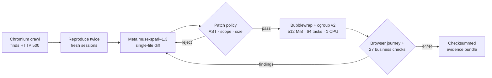

# GitHub showcase audit: FaultLine

**Audit date:** November 2, 2026 (America/New_York), two days before the November 4, 9 PM ET submission deadline.
**Audited revision:** `23ea6f6` on `main` (public repository `FrankieBiz/Faultline`, live judge page `frankiebiz.github.io/Faultline`).
**Scope:** first-contact impact of the repository and judge page, quickstart reproducibility, demo clarity, the `docs/` architecture, GitHub Actions, release packaging, issue templates and community health, and visual storytelling. The project is scored against the Meta hackathon rubric: Impact 30%, Use of Meta AI tooling 25%, Technical depth 20%, Demo 25%.

This is an outside-in review written as a skeptical judge or a first-time developer would experience the project. It is not an organizer score. Every number below was either measured during this audit (see [Method](#method-what-was-actually-run)) or quoted from a linked file in the repository.

---

## 1. Verdict

**FaultLine has real engineering behind it, but its GitHub presence hides that engineering. A judge who gives it 60 seconds on GitHub sees text, tables, and caveats. They see no motion, no Meta-labeled visual, and no video.** The judge page is the strongest asset in the submission, yet the repository treats it as a link instead of reproducing its hero in the README. The `docs/` folder publishes internal self-scoring, unfilled owner placeholders, and growth-hacking notes next to the product documentation. The only image in the README is labeled "not a live Meta trial." Under a rubric where Meta tooling is worth 25%, that is the wrong first picture.

Nearly every problem here is a packaging problem that can be fixed in hours, not a product problem. Two gaps carry real points and need actual work before the deadline:

1. **No demo video is published.** The rubric's Demo criterion explicitly asks for "a demo video worth watching". [`docs/DEVPOST_SUBMISSION.md:13`](../DEVPOST_SUBMISSION.md) still reads `Video: TODO (owner)`.
2. **The generalization proof was run with DeepSeek, not Meta.** The 10-defect corpus, which is the evidence that the repair works beyond one bug, has never been run with `muse-spark-1.3`. A judge scoring "Use of Meta AI tooling" will see a non-Meta model doing the impressive part.

### Scorecard (current state → after the P0/P1 fixes in §9)

| Criterion | Weight | Now (0–10) | Weighted | After fixes | Weighted | Main reason |
| --- | ---: | ---: | ---: | ---: | ---: | --- |
| Impact | 30% | 6.0 | 18.0 | 7.0 | 21.0 | Timely, well-framed problem (unverified AI-written fixes) with one measured result: 5 of 6 wrong patches pass a naive check and none pass FaultLine. It covers one checkout route, has no user evidence, and the impact doc publicly shows empty "to be written" sections. |
| Use of Meta AI tooling | 25% | 5.5 | 13.75 | 7.5 | 18.75 | `muse-spark-1.3` is central, with a structured proposal schema and verifier findings fed back for round two, which goes well beyond a basic wrapper. But Meta evidence covers 3 trials on 1 scenario, the corpus is DeepSeek-only, the claimed Llama support has never been run, the live service is off, and the README hero image is the non-Meta fallback. |
| Technical depth | 20% | 8.5 | 17.0 | 8.5 | 17.0 | Bubblewrap namespaces, cgroup v2 limits read back from the kernel, an AST and import policy, pinned provenance, checksummed bundles, about 1,500 tests, and green CI on three operating systems. The deductions are a crawler crash found in this audit (§6.1) and the fact that the isolation tests are never run in CI. |
| Demo | 25% | 6.0 | 15.0 | 8.0 | 20.0 | The judge page is polished and works with zero install. But there is no video, "Break it yourself" is switched off, the README has no motion, the timing figures conflict, and the "clean" gate replay is captioned as historical. |
| **Total** | | | **63.75 / 100** | | **76.75 / 100** | |

The "after" column assumes only the P0 and P1 items in §9, all of which fit before the deadline. The largest single swing comes from running the corpus with Meta: it moves Meta tooling by up to two points and makes the strongest result attributable to Meta instead of DeepSeek.

---

## 2. Method: what was actually run

| Check | Command or tool | Result |
| --- | --- | --- |
| Cold clone | `git clone https://github.com/FrankieBiz/Faultline.git` into an empty `/tmp` directory | 1 s, 7.8 MB `.git` |
| Setup | `make setup` | **Exit 0 in 14 s.** *Caveat:* the uv, npm, and Playwright caches were already warm on this machine, so a true first run will be slower (unmeasured; the downloads include Chromium, a standalone Python, and three npm trees). |
| Health | `./faultline doctor` | Exit 0. On this machine it reported "Repair Orchestrator Service (port 9000) … Active & Healthy" for a service that belongs to a *different* worktree's demo stack (§6.2). |
| First check with no app | `./faultline test https://frankiebiz.github.io/Faultline/` | PASS, 200 and 200 |
| Gate on the public judge page | `./faultline gate https://frankiebiz.github.io/Faultline/ --json` (3 runs) | **Exit 1, `DEPLOYMENT_BLOCKED`, `crawl_error: page.goto: Download is starting`, all 3 runs** (§6.1) |
| Test count | `pytest --collect-only` on both Python projects | 347 + 1,008 (the README says 345 + 1,008; the badge is static) |
| CI | `gh run list` | All four workflows green on `main` for the last five pushes |
| Repository metadata | `gh repo view`, `gh api …/community/profile` | Description and 10 topics set; homepage set; **0 releases, 0 tags, 48 branches, community health 42%**, wiki enabled, Discussions off, default (auto-generated) social preview |
| Judge page | Playwright screenshots at 1440×900 and 390×844, full-page text dump | 0 console errors; 11,220 px tall; 2,713 words; `faultline-live-api` meta is empty (`docs/index.html:8`), so "Break it yourself" is off |
| GitHub repo page | Playwright screenshot at 1440×900 | The file list fills the first viewport; README is below the fold |
| Links | Script over `README.md`, `docs/*.md`, `docs/evidence/*.md` | 2 `file:///home/frankbiz/...` links in `docs/VOICEOVER_SCRIPT.md`, plus 5 `.agents/judging/...` paths in `docs/EVALUATION_REPORT_MULTI_MODEL.md` that are not in the repository |

---

## 3. The 60-second test

What a judge actually sees, second by second, arriving from Devpost at `github.com/FrankieBiz/Faultline` on a laptop.

| Time | What they see | Problem |
| --- | --- | --- |
| 0–5 s | The GitHub chrome, then a file list: `.agents`, `.githooks`, `.github/workflows`, `apps`, `deploy`, `docs`, `fixtures`, `meta-provided`, … "48 Branches · 0 Tags". The right rail shows a good About text and topics, and "Releases: No releases published". | Nothing visual above the fold (unavoidable on GitHub, which is why the README's first screen matters so much). `.agents` sorts first, and "0 Tags / no releases" reads as unfinished. |
| 5–15 s | The README title: *"FaultLine: Sandbox-Verified Repair and a Pre-Flight Gate for Web Applications"*. Then seven badges, then a 40-word bold sentence naming Bubblewrap and cgroup v2. | The title names two products at once and explains neither in plain language. The tagline leads with infrastructure (Bubblewrap, cgroup v2) rather than the outcome. |
| 15–20 s | The "🧭 Judges Start Here" callout. | **This is good.** It is the one element doing its job. |
| 20–35 s | A 25-line table of contents, then a three-row time and platform table, then a four-row "surfaces" table whose cells run 70+ words (the Inspector row alone is 92 words). | The judge is reading documentation before seeing a single result. |
| 35–50 s | The 3-minute tour, written as prose. Step 2 already carries a caveat ("replays a pass recorded under the earlier contract … captioned as such"). | Caveats reach the judge before the payoff does. |
| 50–60 s | The 2 AM story. The first image is about 115 lines down, roughly four screens. | **By 60 s the judge has seen no screenshot, no GIF, no video, and no Meta-labeled output.** |
| If they do scroll | The only image, `docs/assets/inspector.png`, has the caption *"This screenshot shows the deterministic fallback, not a live Meta trial."* | The single picture in a Meta hackathon README is explicitly not Meta. Its before and after panels also use different denominators: "12 of 18 checks failed" against "44 of 44 checks passed". |

If the judge clicks through to the judge page instead, the experience is much better. The hero is clean, the primary CTA is "Play the recorded Meta repair", and a 3-minute tour card sits in the first viewport (both desktop and mobile verified). **The judge page wins the 60-second test and the README loses it.** The fix is to make the README borrow the judge page's opening, not to make the README longer.

### Ranked friction points (all surfaces)

| # | Friction | Where | Severity |
| ---: | --- | --- | --- |
| F1 | No demo video exists publicly; the Devpost draft still says `Video: TODO (owner)` | `docs/DEVPOST_SUBMISSION.md:13`, `docs/PROJECT_STATUS.md` | Critical (Demo is 25%) |
| F2 | No motion or visual proof above the README fold; the only image is the non-Meta fallback | `README.md:115-117` | Critical |
| F3 | The corpus (generalization proof) has never been run with Meta; DeepSeek did 18 of 20 | `README.md:505`, judge page §06 | High (Meta tooling is 25%) |
| F4 | "Break it yourself" is switched off on the hosted page, while the README promises "watch the model repair it live" | `docs/index.html:8`, `README.md:111` | High |
| F5 | `faultline gate` blocks FaultLine's own judge page with a crawler crash | `tools/browser-runner/src/crawler.ts:955` | High (it is the obvious URL a judge would try) |
| F6 | `docs/` publishes self-scores (55/100, 71/67/79), "to be written by Francis" placeholders, and an X-algorithm growth playbook beside the product docs | `docs/HACKATHON_SCORE_ASSESSMENT.md`, `docs/EVALUATION_REPORT_MULTI_MODEL.md`, `docs/IMPACT_EVIDENCE.md:25,41`, `docs/VIRAL_LAUNCH_KIT.md` | High (anchors a judge's score and signals gaming) |
| F7 | Five different taglines across five surfaces | README, About, judge page, OG tags, `cli.py:1817` | Medium |
| F8 | Conflicting headline numbers: 13.0 s, 10.5 s, 6.9 s; 44, 27, 18 checks | README, judge page | Medium |
| F9 | No release, tags, issue templates, CONTRIBUTING, or SECURITY; community health is 42% | GitHub | Medium |
| F10 | `.agents/` leaks a home-directory path, contains a broken symlink, and vendors third-party and "virality"/"hackathon-judge" skills | `.agents/skills.json`, `.agents/rules/multi-model-orchestration.md`, `.agents/skills/*` | Medium |
| F11 | The judge page's "Run it" section lists only Linux requirements, but the gate runs on macOS and Windows | judge page §07 | Medium |
| F12 | Static test badge (1,530) linked to the Actions list; the platform badge has an empty link `()` | `README.md:5,9` | Low |
| F13 | 48 public branches, mostly agent worktrees | GitHub | Low |
| F14 | Wiki enabled but empty; default social preview card | GitHub settings | Low |

---

## 4. Criterion-by-criterion scoring

### Impact (30%) — 6.0 / 10

**What works**
- The framing is timely and specific. Coding agents ship web changes, and "the error went away" is not "the fix is right". The 2 AM checkout story is concrete, and the shopper-without-a-coupon detail is a nice touch.
- There is a measured, falsifiable claim behind it: on the authored corpus, a naive "returns 201" check accepts 5 of 6 plausible-but-wrong patches, while FaultLine accepts none and names the failing business checks (`docs/IMPACT_EVIDENCE.md`). This is the project's best line, and it is buried.
- The Pre-Flight Gate gives the project a second, broader beneficiary (any team letting agents deploy) and a cross-platform entry point.

**What costs points**
- **The scope is one checkout route in one fixture app.** It is honestly disclosed, but nothing shows the gate or repair touching a codebase the author did not write. *(The CI fixture stores and the AuraScale scratch app are also self-authored.)*
- **The impact document is publicly unfinished.** `docs/IMPACT_EVIDENCE.md:25` reads "**To be written by Francis Bisignano.** …" and line 41 is an empty interview table. A judge who follows the "Impact notes" link from the judge page's criteria table lands on visible blanks.
- **There is no firsthand story.** The "Build for Your World" theme rewards one, and the brief says so.
- The README's top fold sells mechanism (sandbox, cgroups) instead of consequence (orders lost, wrong fixes shipped).

**What moves it (in order of points per hour)**
1. Either fill `IMPACT_EVIDENCE.md` with a real paragraph and two or three real conversations (even short DMs with permission), or remove the placeholder sections from the public tree. Never leave the blank table published.
2. Run `faultline gate` against two or three real, public open-source demo storefronts you did not write (Medusa's or Saleor's demo, a Next.js commerce template on a local port) and publish the verdicts as evidence, even when they are `SAFE_TO_DEPLOY`. "Ran against code I didn't write" is the single most persuasive impact signal still missing.
3. Lead the README with the 5-of-6 result (see the §7 rewrite).

### Use of Meta AI tooling (25%) — 5.5 / 10

**What works**
- `muse-spark-1.3` is the repair core, not decoration. It produces a schema-bound proposal, receives untrusted-evidence framing, and gets the verifier's structured findings back for a second round. That is the "creative use beyond a basic integration" the rubric asks for.
- The provenance discipline is exceptional: `trial_ledger.py --require-provider meta` refuses non-Meta responses, and provider identity is derived from the endpoint host. This is worth *saying out loud* to judges, because most entries cannot prove which model answered.
- There are 3 of 3 first-attempt verified live trials (median 10.5 s), plus two checksummed Meta replays.

**What costs points**
- **The generalization result belongs to DeepSeek.** The README's own words at line 505 are "A non-Meta model (DeepSeek `deepseek-v4-pro` …) verified 18 of 20 runs … **A Meta run over the full corpus has not been recorded yet.**" A judge in the Meta-tooling column reads that as "the impressive number came from a competitor."
- **The README's hero image is the deterministic fallback**, captioned "not a live Meta trial".
- **"Llama-3.3-70B-Instruct is supported"** appears on the judge page with "Not yet shown: … a recorded Llama run." Claiming support without a run reads as padding. Either run it or cut it.
- **Only one Meta model and one Meta surface are used.** The event lists Muse Code, open weights, Muse Image, and SAM. There is no need to bolt on gimmicks, but a recorded open-weights run (the $10k "Best Build on Meta Open Weights" bonus is listed in `docs/HACKATHON_BRIEF.md`) would materially widen the story.
- The live service is off, so no judge can trigger a Meta call during judging.

**What moves it**
1. **P0: run `./scripts/evaluate.sh` with `META_API_KEY` set and `muse-spark-1.3`, two runs per variant (20 runs, roughly 10 s each), record it with the same ledger discipline, and publish `docs/evidence/2026-11-0X-evaluation-meta.{json,md}`.** Whatever the outcome (including failures the gates catch), it converts the 25% criterion from "3 trials on one bug" to "Meta on ten unseen defects under adversarial gates". If Meta scores lower than DeepSeek, publish it anyway: gates catching Meta's wrong patches *is the product working*.
2. Replace `docs/assets/inspector.png` with a screenshot of a **Meta** run (provider label `meta`, `muse-spark-1.3`), keeping the same honest caption style.
3. Either record one Llama run through the Meta Model API or delete the Llama sentence.
4. Turn the live service on for the judging window (Nov 4–8), or reword every "watch it live" promise to "replay".

### Technical depth (20%) — 8.5 / 10

This is where the project is genuinely ahead of typical hackathon entries, and an experienced engineer reading the six-step section will notice.

- The isolation is real: `bwrap --unshare-all --cap-drop ALL --clearenv`, read-only mounts, and cgroup v2 limits (512 MiB, no swap, 64 tasks, 1 CPU) **read back from `/sys/fs/cgroup` before execution**. It fails closed.
- The patch policy is substantive: AST allowlist, catch-all exception rejection (a smart, domain-specific rule), size caps, hunk recount, and stale-hash rejection.
- Evidence engineering: checksummed bundles, an offline verifier, static script-free replays, and honest limits ("not a VM, no seccomp").
- Test and CI depth: 1,355 Python tests collected in this audit, plus runner and browser suites; `make check` covers Ruff, strict mypy, provenance, and builds. Four workflows are green on `main`, and setup plus a real Chromium gate are smoke-tested on `macos-latest` and `windows-latest`.

**Deductions**
- **§6.1: the crawler crashes on a download link**, and the bundled public page triggers it. A depth-minded judge who runs `gate` on the only public URL in the README gets a `crawl_error` and a misleading "make sure the preview server is running" prompt.
- **The crown-jewel claim (kernel isolation) is never exercised in CI.** `make integration` is run only on the author's Fedora box; `faultline-ci.yml` installs `bubblewrap` and then states it makes no sandbox claim. That is honest, but it means a judge can only take the isolation on trust or on a recorded JSON file.
- Repairs are single-file diffs on one route. This is disclosed, and fine for a hackathon.

**What moves it:** fix §6.1 (small); add an experimental CI job attempting `make integration` on `ubuntu-latest` (§5.5), and publish its result either way.

### Demo (25%) — 6.0 / 10

**What works**
- The judge page is the best artifact in the submission. It has a strong hero, a primary CTA that plays a recorded Meta repair at real timing, a 3-minute tour card in the first viewport, an adversarial patch explorer, a criteria table with a "Not yet shown" line per row, zero console errors, and it holds up on a 390 px phone.
- Evidence-first honesty runs throughout: every replay is checksummed and every fallback is labeled. This is a real differentiator against demo-ware.

**What costs points**
- **No video** (F1). The rubric literally asks for "a demo video worth watching". `docs/VOICEOVER_SCRIPT.md` shows rough cuts exist locally (2:13.8 and 2:39.5) but they are not published, and the doc links them via `file:///home/frankbiz/...` paths that 404 for everyone else.
- **"Break it yourself" is off** (F4). The page handles this honestly, but the most interactive feature is dark.
- **Gate tour step 2 replays an external app (AuraScale) that is not in the repository**, and the "clean" verdict is captioned as recorded "under the earlier contract". Two caveats in the step a judge is supposed to be impressed by.
- **Conflicting numbers** (F8). The hero strip says "Meta patch in 6.9 s", the tour says "13.0 s", and the ledger says "median 10.5 s". They are different measurements (model latency, end-to-end job, and a separate 3-trial median), but nothing on the page says so. On checks, the README says "44/44 passing checks" and "27 independent HTTP business assertions", and the screenshot says "12 of 18 checks failed". A skeptical judge will think the numbers don't add up.
- **Length.** The judge page is 11,220 px and 2,713 words, and the README is 569 lines (45 KB). Judges will not read either fully. That is fine *only if* the top 900 px carries the whole story, which on the judge page it nearly does and in the README it does not.

**What moves it:** publish the video (unlisted YouTube is enough) and embed it as the first element of both the README and the judge page; re-record both gate verdicts against the bundled BuggyShop (blocked) and the patched BuggyShop (clean) under the current contract, then delete both caveats; label the three timings explicitly ("model: 6.9 s · full verified job: 13.0 s · 3-trial median: 10.5 s").

---

## 5. Surface-by-surface audit

### 5.1 README.md

| Aspect | Assessment |
| --- | --- |
| Title | Two products joined by "and", and jargon-first. It does not say what happens to the user. |
| Badges | Seven badges. "tests 1,530 passing" is a **static shields.io badge** linked to the Actions list, which looks live but is not. It drifts already: the README says 345 backend tests and this audit collected 347. "Platform" links to `()`. There is no badge from an actual workflow. |
| Tagline | 40 words, bold, and it names Bubblewrap and cgroup v2 before the user benefit. |
| "Judges Start Here" | Excellent. Keep it, but move it *above* the badges, or make it the second line. |
| TOC | 25 lines of emoji-prefixed anchors. GitHub already renders an outline button, so this costs a full screen for little gain. |
| Body | Accurate, careful, exhaustive. It reads as a reference manual, not a showcase. The 92-word "Inspector studio" table cell and the 600-word `crawl` paragraph (lines 360–389) belong in `docs/`. |
| Visuals | One static screenshot, the fallback, four screens down. No GIF, video, or architecture diagram. |
| Honesty | A real strength, but over-applied above the fold. Caveats belong next to the claims they qualify, collected in "Scope and limits" (which already exists and is good), not interleaved into the tour. |
| Hackathon materials | Links to the score assessment and status pages, which invites the judge to read the 55/100 self-score (see §5.3). |

**Concrete rewrite:** see §7.

### 5.2 Quickstart reproducibility

- **The good news is real.** A fresh clone plus `make setup` succeeded unattended (exit 0), `doctor` and `test` both passed, and `--help` is clean. The platform matrix (README lines 127–133) is the clearest table in the repository. The Windows and macOS paths are actually exercised in CI, which very few hackathon entries can say.
- **Time-to-first-wow is too long for a judge without the demo stack.** The path is clone, `make setup` (minutes cold), `./faultline demo` in one terminal, then a second terminal. A judge on macOS who just wants to *see the gate catch something* has no single command for that.
  **Suggestion:** add `./faultline gate --self-test` (or `make wow`). It boots the two in-repo fixture stores that `faultline-gate.yml` already defines inline, gates both, and prints `SAFE_TO_DEPLOY` then `DEPLOYMENT_BLOCKED` with the fix prompt, all within 30 s, on any OS. The fixture JavaScript exists already in the workflow; it just needs to move into `fixtures/` and get a launcher.
- **The obvious "no app" experiment fails.** The README suggests `test https://frankiebiz.github.io/Faultline/` as "a harmless first check". The natural next step, `gate` on the same URL, crashes (§6.1).
- **The doctor reports false health in multi-checkout setups.** It reported a foreign service on :9000 as "Active & Healthy" (§6.2).
- **The full clone is required** (the fixture is pinned to history). The README states this, but "Download ZIP" is GitHub's most visible button. Consider a `setup.sh` check that prints a one-line fix when `.git` is missing or shallow.
- **The judge page's "Run it" section** (§07) lists only Linux prerequisites and `make check` (minutes), so a Mac-owning judge concludes they can't run anything. Add a three-line cross-platform "gate only" path above the Linux block.

### 5.3 Documentation architecture (`docs/`)

There are 21 Markdown files flat in `docs/`, totaling 5,184 lines. They mix four audiences with no index:

| Audience | Files | Recommendation |
| --- | --- | --- |
| **Users and developers** | `CLI_CHECK.md`, `PREFLIGHT_GATE.md`, `PROJECT_RUNNER.md`, `EVALUATION.md` | Keep. Move to `docs/guides/` and add a `docs/README.md` index. |
| **Evidence** | `docs/evidence/*`, `docs/replay/*`, `SUBMISSION.md` (technical dossier), `QUALITY_REVIEW.md` | Keep. These are the project's moat. |
| **Submission production** | `DEVPOST_SUBMISSION.md` (with an owner TODO block), `VIDEO_STORYBOARD.md`, `VOICEOVER_SCRIPT.md` (with `file:///` links), `LAUNCH.md`, `VIRAL_LAUNCH_KIT.md`, `HACKATHON_BRIEF.md` | **Remove from the public `main` tree before judging** (keep on a private branch or in an ignored folder). They are working notes, and `VIRAL_LAUNCH_KIT.md` (X algorithm weights, "Never put external links in the root post") reads as engagement farming to a judge who opens it. |
| **Internal planning and self-assessment** | `HACKATHON_SCORE_ASSESSMENT.md` ("Why FaultLine received 55/100"), `EVALUATION_REPORT_MULTI_MODEL.md` (71/67/79 from prompted models, references to five `.agents/judging/*` files that are not in the repo, and a stale 1,211 test count), `CHRONOLOGICAL_ADJUSTMENTS.md`, `PROJECT_STATUS.md`, `SpecV1.md`, `SpecV1-research-notes.md`, `PLATFORM_DX_SPEC.md` (1,128 lines, "Proposed design … awaiting owner approval"), `LONG_TERM_RESEARCH_AND_IDEAS.md` (1,463 lines) | **Move out of the judged surface.** A judge who sees "55/100" in a filename anchors to it. A "Projected Score Post-Fixes: 79/100" table invites the question "who scored this?" The specs are fine to keep but belong under `docs/design/` and are clearly labeled historical. |

Proposed layout:

```text
docs/
  README.md                 # one-screen index: "Start here / Use it / Evidence / Design"
  index.html                # judge page (GitHub Pages root, unchanged)
  guides/                   # CLI_CHECK, PREFLIGHT_GATE, PROJECT_RUNNER
  evidence/                 # unchanged + EVALUATION.md, QUALITY_REVIEW.md, SUBMISSION.md
  replay/                   # unchanged
  design/                   # SpecV1*, PLATFORM_DX_SPEC (marked historical/proposed)
  assets/                   # hero.gif, social-preview.png, inspector-meta.png, architecture.svg
  audits/                   # this file
```

Moving files will break the links in `README.md`, `docs/index.html`, and between the docs. Run the link check from §2 after the move. GitHub Pages serves `docs/`, so check that the judge page's own relative links (`replay/…`, `assets/…`) still resolve.

### 5.4 Visual storytelling

| Asset | Status | Gap |
| --- | --- | --- |
| Hero GIF or video in the README | None | The single most valuable missing asset |
| Product screenshot | `docs/assets/inspector.png`, the fallback run | Should be a Meta run |
| Architecture diagram | None (the six-step engine is prose) | One Mermaid diagram renders natively on GitHub at no asset cost |
| Social preview (link unfurls on X, LinkedIn, Slack, Devpost) | GitHub's auto-generated card; the judge page's `og:image` reuses the fallback screenshot | A 1280×640 branded card |
| Demo video | Not published | Critical |
| Judge page | Strong | Needs the video at the top |

Mermaid diagram to paste under "How it works" (replace nothing; add above the six prose steps):

````markdown

````

### 5.5 CI/CD (GitHub Actions)

**Strengths.** All actions are pinned to commit SHAs with version comments, permissions are `contents: read`, timeouts are set, failure artifacts are uploaded, the macOS and Windows smoke runs exist, and `faultline-gate.yml` is a genuinely nice drop-in. It self-tests in both directions (a healthy store must pass, a broken store must block) and writes the verdict to the job summary. That workflow is a showcase asset in itself and deserves a screenshot in the README.

**Gaps**

| # | Finding | Fix |
| ---: | --- | --- |
| C1 | `check.yml` and `platform-smoke.yml` trigger on every `push` *and* every `pull_request` with no branch filter or concurrency group, so each PR commit runs them twice and every one of the 48 agent branches burns runners (the run list shows identical "Verify" runs on `main`, `FrankieBiz/claude-frontier-ui-polish`, and `FrankieBiz/schedule-cloud-agent-routines`) | Add `push: branches: [main]` and `concurrency: {group: ${{ github.workflow }}-${{ github.ref }}, cancel-in-progress: true}` |
| C2 | The sandbox (`make integration`) is never run in CI | Add a `continue-on-error: true` job on `ubuntu-latest` that tries `sudo sysctl -w kernel.apparmor_restrict_unprivileged_userns=0`, `sudo loginctl enable-linger runner`, sets `XDG_RUNTIME_DIR`, and runs `make integration`. *Unverified whether hosted runners can delegate cgroup controllers to a user scope; treat it as an experiment and record the outcome either way.* A green isolation badge would be the strongest single technical-depth signal. |
| C3 | Dependabot is missing, even though SHA-pinned actions need it to stay current | Add `.github/dependabot.yml` for `github-actions`, `npm` (three directories), and `uv`/`pip` |
| C4 | No Pages smoke test, and the judge page is the primary demo surface | Add a scheduled job that runs `./faultline test` **and** `./faultline gate` against `https://frankiebiz.github.io/Faultline/`. This dogfoods the product on its own showcase and would have caught §6.1. |
| C5 | No link check | Add `lycheeverse/lychee-action` (pinned SHA) over `README.md` and `docs/**/*.md` |
| C6 | No README badges come from real workflows | Use `actions/workflows/check.yml/badge.svg`, `faultline-gate.yml/badge.svg`, and `platform-smoke.yml/badge.svg` |
| C7 | No release workflow | See §5.6 |

### 5.6 Release packaging

The repository has **0 releases and 0 tags**. "Releases: No releases published" sits in the right rail of the first viewport. A release is also the cleanest way to freeze "the submitted commit", which the Devpost draft's own checklist asks for ("record the commit hash").

Cut `v0.9.0-hackathon` (or `v1.0.0`) on the commit you submit, with these assets attached:
- `faultline-evidence-<sha>.zip`: `docs/evidence/` plus the three replays, with `SHA256SUMS`.
- The two Python distributions `make build` already produces (`dist/*.whl`, `*.tar.gz`).
- The demo video file (GitHub releases accept files up to 2 GB), so the video survives even if a host link dies.

Draft release notes:

```markdown
## FaultLine v0.9.0 — Meta Global AI Developer Hackathon submission

A real browser finds the failure. Meta's muse-spark-1.3 writes a one-file patch.
Independent business checks decide whether it works, inside a kernel-limited sandbox.

**Try it in 3 minutes, no install:** https://frankiebiz.github.io/Faultline/
**Video:** <link>

### What's in this release
- `faultline gate URL` — pre-deployment gate for coding agents and CI (macOS, Windows, Linux)
- `faultline scan` / `crawl` — autonomous same-origin crawl that stops at the first defect
- Sandbox-verified repair (Linux): Bubblewrap namespaces + cgroup v2, AST patch policy,
  verifier feedback loop, checksummed evidence bundles

### Evidence (all checksummed, attached)
- 3/3 live muse-spark-1.3 trials verified first attempt, 44/44 checks, median 10.5 s
- Naive "HTTP 201" check ships 5 of 6 wrong patches; FaultLine ships 0
- <Meta corpus result once recorded>

### Known limits
One registered live scenario; single-file diffs; namespaces + cgroups, not a VM.
Full list: README → Scope and limits.
```

### 5.7 Issue templates and community health

GitHub's community profile scores **42%**: there is a README and a LICENSE, but no CONTRIBUTING, CODE_OF_CONDUCT, SECURITY, issue templates, or PR template. A repository whose whole pitch is *running untrusted code safely* has no `SECURITY.md`. That is the first file a security-minded judge looks for.

Recommended files:

**`.github/ISSUE_TEMPLATE/gate-verdict.yml`**, a product-specific template that also signals the tool is meant for real use:

```yaml
name: Gate verdict looks wrong
description: faultline gate blocked a healthy app, or passed a broken one
labels: [gate, triage]
body:
  - type: dropdown
    id: kind
    attributes:
      label: What happened?
      options: [False block (app is fine), False pass (app is broken), Crawl error]
    validations: {required: true}
  - type: input
    id: version
    attributes: {label: "Output of `faultline version`"}
    validations: {required: true}
  - type: dropdown
    id: os
    attributes: {label: OS, options: [Linux, macOS, Windows, WSL2]}
  - type: textarea
    id: json
    attributes:
      label: "`faultline gate URL --json` output"
      description: Remove secrets and private URLs.
      render: json
    validations: {required: true}
  - type: textarea
    id: expected
    attributes: {label: What did you expect?}
```

Also add:
- `bug-report.yml` (with `faultline doctor` output as a required field) and `config.yml` with `blank_issues_enabled: false` plus a contact link to the judge page.
- `SECURITY.md`: the threat model in five lines (namespaces plus cgroups, no seccomp, shared kernel), the private reporting route (enable GitHub private vulnerability reporting), and the scope.
- `CONTRIBUTING.md`: `make setup`, `make check`, `make browser`, plus the provenance rule for `fixtures/` and `meta-provided/`.
- `.github/PULL_REQUEST_TEMPLATE.md` with a "make check output" checkbox.
- Enable **Discussions** if you plan to campaign for the Community Vote bonus. Disable the empty **Wiki**.

### 5.8 Repository hygiene

| Finding | Evidence | Recommendation |
| --- | --- | --- |
| A local home path is published | `.agents/skills.json` contains `"/home/frankbiz/.agents/skills"` | Remove the file from the public tree |
| A broken symlink | `.agents/rules/multi-model-orchestration.md -> ../../AGENTS.md`; `AGENTS.md` is gitignored, so the link is dangling for every cloner | Remove it |
| Vendored third-party and internal skills | `.agents/skills/` ships `frontend-design` (with its own Apache LICENSE), `systematic-debugging`, `using-git-worktrees`, `orca-cli`, `orchestration`, `hackathon-judge` (incl. `judge.py`), and `virality` (X and LinkedIn algorithm notes) | Keep **only** `faultline-gate`, which is a product feature linked from the README and `PREFLIGHT_GATE.md`. Remove the rest from `main`. A `hackathon-judge` skill sitting in a judged repository is a bad look regardless of intent. |
| `file:///` links | `docs/VOICEOVER_SCRIPT.md` (2) | They go away with the §5.3 move |
| 48 branches | `gh api …/branches` | Delete merged agent branches after the deadline (this is an owner action; it is outward-facing, so it was not done here) |
| Webinar slides | `meta-provided/` (4.1 MB of Meta webinar screenshots) | Confirm that redistribution is acceptable. Linking to the official pages is enough for judges. |

---

## 6. Defects found during the audit

### 6.1 `faultline gate` crashes on download links. It blocks FaultLine's own judge page.

**Reproduction (deterministic, 3 of 3 runs):**

```bash
./faultline gate https://frankiebiz.github.io/Faultline/ --json
# exit 1
# {"verdict":"DEPLOYMENT_BLOCKED","stop_reason":null,
#  "error":{"code":"crawl_error","message":"Crawl stopped unexpectedly: page.goto: Download is starting"}}
```

**Cause.** The crawler follows the judge page's link to `replay/3573b32b-…/SHA256SUMS` (a `text/plain` file served as a download). `navigate()` at `tools/browser-runner/src/crawler.ts:955` calls `page.goto` on it, Playwright throws `Download is starting`, and the outer handler at `crawler.ts:1118` turns that into a crawl error. The gate then tells the user to "Make sure the preview server is running", which is misleading.

**Why it matters for judging.** The README offers that URL as the safe first target (`README.md:219`). The very next thing a curious judge runs is `gate` on it, and the result is FaultLine blocking its own showcase with an internal error. This undermines the "deterministic, fail-closed gate" claim at the exact moment of first contact.

**Suggested fix (not applied; this audit is report-only).** Skip candidate URLs with non-HTML extensions or a `download` attribute when collecting unvisited links. Catch `Download is starting` in `navigate()`, record it as a skipped navigation, and continue exploring instead of erroring. Add a runner unit test with a fixture page linking to a `.txt` attachment, and add the Pages gate smoke from §5.5 (C4).

### 6.2 `doctor` reports foreign services as healthy

In a fresh clone on a machine where another checkout's demo stack was running, `doctor` reported `Repair Orchestrator Service (port 9000) … Active & Healthy`. The `demo` launcher already checks process ownership. `doctor` should either do the same or word the line "something healthy is answering on :9000 (not verified as this checkout)". This is low severity, but it is exactly the sort of over-claim the project is otherwise careful to avoid.

### 6.3 Messaging and number drift

Five taglines are in circulation:

| Surface | Current wording |
| --- | --- |
| README H1 | "Sandbox-Verified Repair and a Pre-Flight Gate for Web Applications" |
| GitHub About | "Sandbox-verified automated repair and browser pre-flight deployment gate for web applications." |
| Judge page hero | "The autonomous immune system for AI coding agents and web applications." |
| `og:title` | "FaultLine: verified checkout repair" |
| CLI `--help` (`cli.py:1817`) | "Autonomous SRE and sandbox-verified repair platform." |

Pick one sentence and use it everywhere (§7.1). "Autonomous SRE" and "immune system" overclaim relative to the README's own scope ("no continuous production monitoring"), and a careful judge will notice that mismatch.

The numbers need labels wherever they appear:

| Value | What it actually is | Label it as |
| --- | --- | --- |
| 6.9 s | `muse-spark-1.3` generation time for job `3573b32b` | "model time" |
| 13.0 s | That job end to end | "full verified repair" |
| 10.5 s | Median of the 3 Oct 31 ledger trials | "3-trial median" |
| 44 | Browser journey checks + 27 HTTP business assertions on the candidate | "44 checks (27 business assertions + browser journey)" |
| 18 | Baseline checks that ran before the first failure stopped the baseline | Show "baseline: failed" rather than "12 of 18" |

---

## 7. Concrete rewrites

### 7.1 One positioning line

> **FaultLine won't let an AI fix ship until a real browser proves it works.**

Sub-line: *A browser reproduces the failure, Meta's `muse-spark-1.3` writes the patch, and independent business checks decide whether it ships, inside a kernel-limited sandbox.*

Use it for the README H1 subtitle, the About field (≤ 350 characters), `og:title` and `og:description`, the CLI `description=`, and the Devpost tagline.

### 7.2 README: the first screen (replaces lines 1–45)

Everything below links to existing evidence. Nothing new is claimed, and `<VIDEO_URL>` is the only placeholder, waiting on F1.

````markdown
<p align="center">
  <a href="https://frankiebiz.github.io/Faultline/">
    
  </a>
</p>

<h1 align="center">FaultLine</h1>
<p align="center"><b>Won't let an AI fix ship until a real browser proves it works.</b></p>

<p align="center">
  <a href="https://frankiebiz.github.io/Faultline/"><b>▶ Try it in your browser — 3 min, no install</b></a> ·
  <a href="<VIDEO_URL>">Watch the 2-min video</a> ·
  <a href="#quickstart">Run it locally</a>
</p>

<p align="center">
  <a href="https://github.com/FrankieBiz/Faultline/actions/workflows/check.yml"></a>
  <a href="https://github.com/FrankieBiz/Faultline/actions/workflows/faultline-gate.yml"></a>
  <a href="https://github.com/FrankieBiz/Faultline/actions/workflows/platform-smoke.yml"></a>
  
  <a href="LICENSE"></a>
</p>

| | Naive check ("did it return 201?") | FaultLine |
| --- | :---: | :---: |
| Plausible-but-wrong patches shipped | **5 of 6** | **0 of 6** |
| Live `muse-spark-1.3` repairs verified | — | **3 of 3**, first attempt, median 10.5 s |
| Where the patch runs | your app | Bubblewrap namespaces + cgroup v2 (512 MiB · 64 tasks · 1 CPU) |

<sub>Authored 11-patch corpus on one checkout route; <a href="docs/evidence/2026-10-31-controller-ledger-meta.md">Meta ledger</a> ·
<a href="docs/EVALUATION.md">evaluation method</a> · <a href="#scope-and-limits">limits</a>.</sub>

### Gate your agent's deploys in one line (macOS · Windows · Linux)

```bash
./faultline gate https://your-preview.example --json   # exit 0 SAFE_TO_DEPLOY · exit 1 DEPLOYMENT_BLOCKED + fix prompt
```
````

After that come the 2 AM story (keep it, it is good), the Mermaid diagram (§5.4), the quickstart, and then the existing reference sections. Move the long `crawl`/`scan` and Inspector material to `docs/guides/` with a one-line link each. **Target: README under 250 lines.** Delete the hand-written TOC.

### 7.3 Judge page tweaks (`docs/index.html`)

1. Put the video, or the hero GIF as a poster linking to it, directly under the hero CTAs.
2. Hero headline: replace "The autonomous immune system for AI coding agents and web applications" with the §7.1 line. It overclaims compared with the page's own "What this does not claim" section.
3. Proof strip: "Meta patch in 6.9 s" → "Meta patch: 6.9 s model time". Label 13.0 s as "full verified repair".
4. §07 "Run it": add a cross-platform gate-only block *before* the Linux block:
   `git clone … && cd Faultline && make setup && ./faultline gate http://localhost:3000`.
5. Point `og:image` at the new `assets/social-preview.png` (§8.2), not the fallback screenshot.
6. After re-recording the gate verdicts against BuggyShop, delete the AuraScale and "earlier contract" captions.

---

## 8. Asset plan

FaultLine's whole credibility rests on *recorded, not rendered*. **Product visuals must be real captures.** Generative imagery is appropriate only for brand framing (backgrounds and plates), never for UI, numbers, or terminal output.

### 8.1 Hero GIF, recorded and not generated → `docs/assets/hero.gif`

Capture the judge page's own recorded Meta replay. It already plays at real timing, and its provenance is checksummed.

```bash
# Record the judge page's "Play the recorded Meta repair" at 1280x720 (Playwright, any checkout with the runner installed)
cat > /tmp/rec.cjs <<'EOF'
const { chromium } = require(process.argv[2]);
(async () => {
  const b = await chromium.launch();
  const ctx = await b.newContext({ viewport: { width: 1280, height: 720 }, recordVideo: { dir: '/tmp/rec', size: { width: 1280, height: 720 } } });
  const p = await ctx.newPage();
  await p.goto('https://frankiebiz.github.io/Faultline/', { waitUntil: 'networkidle' });
  await p.getByRole('button', { name: /Play the recorded Meta repair/ }).click();
  await p.waitForTimeout(16000);
  await ctx.close(); await b.close();
})();
EOF
node /tmp/rec.cjs "$PWD/tools/browser-runner/node_modules/playwright"
# Trim to the 13 s replay, 12 fps, 880 px wide, palette-optimized (target < 5 MB)
ffmpeg -i /tmp/rec/*.webm -vf "fps=12,scale=880:-1:flags=lanczos,split[a][b];[a]palettegen=max_colors=96[p];[b][p]paletteuse=dither=bayer" -loop 0 docs/assets/hero.gif
```

Alternatively, drag the MP4 into the GitHub README editor to get a `user-attachments` URL, which renders an inline player, keeps quality, and avoids repository bloat.

### 8.2 Social preview card → `docs/assets/social-preview.png` (1280×640)

Upload it under **Settings → General → Social preview** (there is no API for this; it is an owner step) and reference it from `og:image`. The composition should be the Gemini-generated plate below with a **real** screenshot composited on top: the Inspector's "Verified repair · 44 of 44" panel from a *Meta* run, plus the §7.1 line in type.

---
### 🎨 Asset Generation Handoff for Gemini (Antigravity)

**Target location**: `docs/assets/social-preview-plate.png` (background plate only; the real UI screenshot and the headline text are composited afterward)
**Aspect ratio / size**: `2:1`, 1280×640
**Aesthetic style**: Dark technical editorial. Near-black `#05070A` field and a single fault-line motif matching the judge page's favicon (a diagonal split between a red-pink `#FF4D6A` triangle and a mint `#3DFFA2` triangle). Restrained, with no gradients-on-gradients and no purple.

**Prompt to give Gemini**:
> "Generate a 1280×640 dark background plate for a developer-tool social card. Near-black field (#05070A) with subtle fine-grain noise and a faint engineering grid at 4% opacity. One thin, precise diagonal fracture line crosses from lower-left to upper-right; to its left a faint warm red-pink glow (#FF4D6A, very low intensity), to its right a faint mint glow (#3DFFA2, very low intensity), like a seismograph trace splitting a failure from a fix. Leave the right 60% of the canvas calm and empty for a UI screenshot overlay, and the top-left quarter empty for a headline. No text, no logos, no UI, no numbers, no people, no 3D objects, no watermarks. Matte, minimal, Linear/Vercel-grade restraint. Save to `docs/assets/social-preview-plate.png`."
---

Once the plate exists, composite `docs/assets/inspector-meta.png` (§8.3) on the right with a 1 px `#1F2430` border and 12 px radius, then set the §7.1 line top-left in the judge page's sans at 56 px. Export it as `docs/assets/social-preview.png`.

### 8.3 Replace the README screenshot → `docs/assets/inspector-meta.png`

Run one live Meta job on the demo stack with `META_API_KEY` set and screenshot the Inspector's "Run result" panel at 1440 width, so the "Patch source" line reads `meta · muse-spark-1.3`. Keep the honest caption pattern: *"Recorded live Meta run, job `<id>`, <date>."* Keep the existing fallback image only in `docs/guides/` for the no-key path.

### 8.4 Demo video, from existing material

Rough cuts already exist (`docs/VOICEOVER_SCRIPT.md`: a 2:13.8 standard cut and a 2:39.5 extended cut). Finish the voiceover for the **standard cut**: judges reward brevity, and the extended cut's extra gate clip is better covered by the README one-liner. Publish it as unlisted YouTube with captions, attach the MP4 to the GitHub release, and embed the link in three places: README line 1 area, the judge page hero, and the Devpost video field. **The first 5 seconds must show the red HTTP 500**, as the storyboard already prescribes.

---

## 9. Prioritized action plan (deadline: Nov 4, 9 PM ET)

| P | Action | Criterion moved | Effort |
| --- | --- | --- | --- |
| **P0** | Finish and publish the video; link it from the README, judge page, Devpost, and release | Demo | 2–4 h |
| **P0** | Run the 10-defect corpus with `muse-spark-1.3`; publish the evidence; update the README and judge page "Not yet shown" lines | Meta tooling, Impact | 1–2 h plus API time |
| **P0** | Fix the crawler download crash (§6.1) and add a test; re-run `gate` on the judge page until it exits 0 or gives a legitimate verdict | Technical depth, Demo | 1 h |
| **P0** | Remove `HACKATHON_SCORE_ASSESSMENT.md`, `EVALUATION_REPORT_MULTI_MODEL.md`, `VIRAL_LAUNCH_KIT.md`, `LAUNCH.md`, `DEVPOST_SUBMISSION.md`, `VOICEOVER_SCRIPT.md`, `VIDEO_STORYBOARD.md`, and `CHRONOLOGICAL_ADJUSTMENTS.md` from public `main`; fix or remove the `IMPACT_EVIDENCE.md` placeholders; update the README "Hackathon materials" links | Impact, overall impression | 30 min |
| **P1** | README first screen rewrite (§7.2), with the hero GIF (§8.1) and Mermaid diagram (§5.4) | Demo, Impact | 2 h |
| **P1** | Meta-run screenshot replaces the fallback image (§8.3) | Meta tooling | 20 min |
| **P1** | Turn on the live repair service for Nov 4–8, or reword "watch it live" everywhere | Demo, Meta tooling | 1 h (VM) |
| **P1** | Re-record both gate verdicts against BuggyShop under the current contract; delete the AuraScale and "earlier contract" captions | Demo | 30 min |
| **P1** | Unify the tagline (§6.3, §7.1) and label every timing and check count | Demo | 30 min |
| **P1** | Tag `v0.9.0-hackathon` on the submitted commit and publish a release with evidence assets (§5.6) | Demo, polish | 30 min |
| **P2** | `SECURITY.md`, `CONTRIBUTING.md`, issue templates (§5.7); disable the Wiki | Polish | 45 min |
| **P2** | Clean `.agents/` down to `faultline-gate` only; remove `skills.json` and the broken symlink (§5.8) | Polish | 10 min |
| **P2** | CI: branch filters and concurrency, the Pages gate smoke, Dependabot, link check (§5.5 C1, C3–C6) | Technical depth | 1 h |
| **P2** | Social preview card (§8.2) | Virality, Demo | 30 min plus Gemini |
| **P2** | `./faultline gate --self-test` cross-platform 30-second wow command (§5.2) | Demo | 1–2 h |
| **P3** | Experimental `make integration` job on `ubuntu-latest` (§5.5 C2) | Technical depth | 1–2 h, outcome uncertain |
| **P3** | `docs/` restructure (§5.3) with a link re-check | Polish | 1 h |
| **P3** | `doctor` ownership wording (§6.2); a Llama run or deleting the Llama claim | Technical depth, Meta tooling | 30 min |
| **After the deadline** | Prune the 48 branches; gate public third-party storefronts for impact evidence | Impact | — |

---

## 10. What not to change

- **The honesty discipline.** Labeled fallbacks, "Not yet shown" rows, the ledger that refuses non-Meta responses, and the "What this does not claim" section are rare in hackathon entries. Experienced judges will reward them. The recommendation is to *move* caveats next to their claims and out of the first screen, not to delete them.
- **The judge page's structure.** The hero, the 3-minute tour card, the patch explorer, and the criteria table with evidence links all work. Change the words and the top media slot, not the layout.
- **`faultline-gate.yml`.** It is a copy-paste-ready product surface with a bidirectional self-test. Promote it.
- **The platform matrix table** (README lines 127–133). It is the clearest explanation of what runs where.
