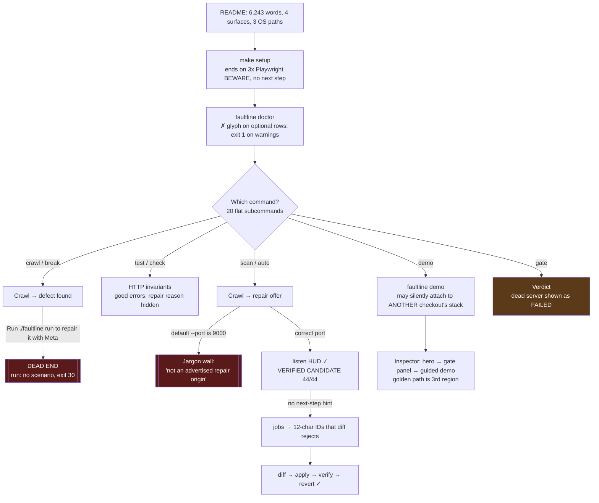
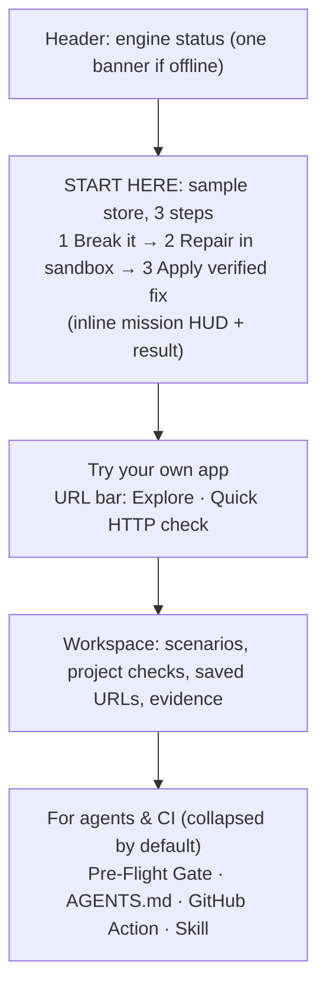
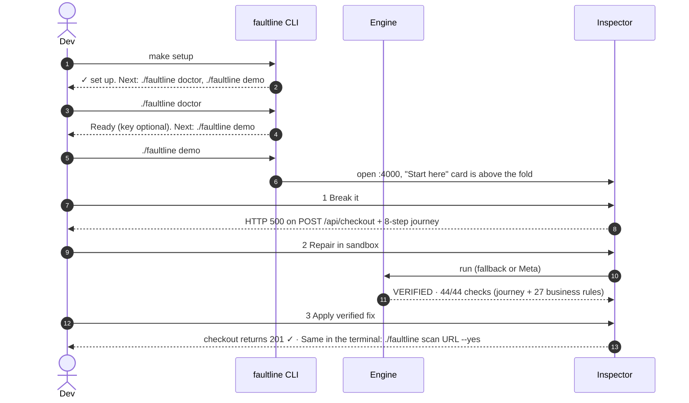
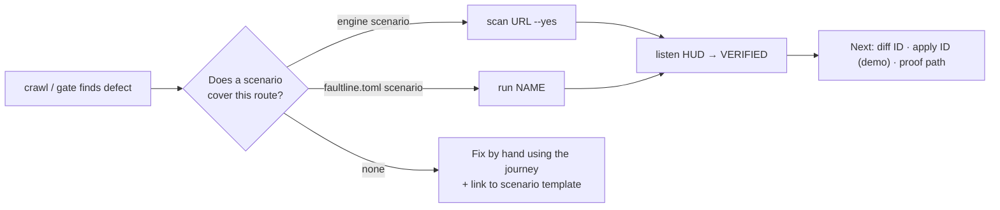
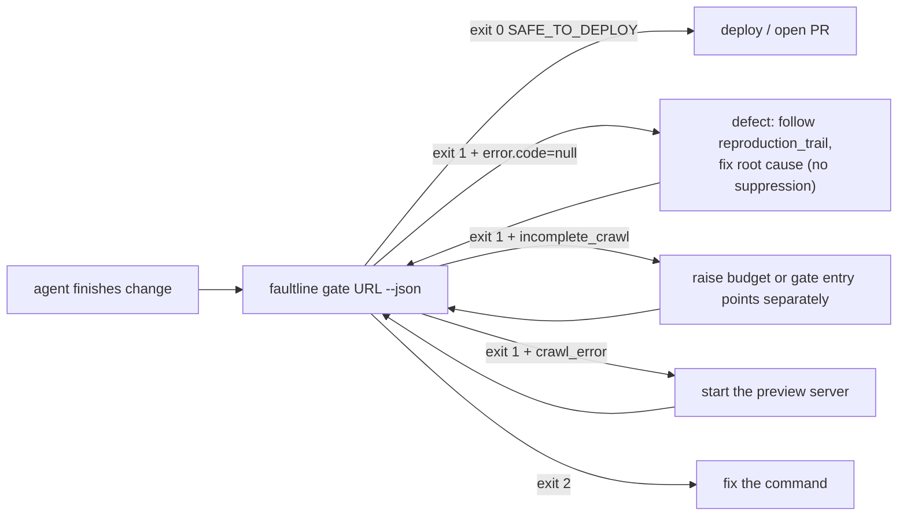

# FaultLine UX and Developer-Journey Audit

**Date:** 2026-11-02
**Commit audited:** `23ea6f6` (branch `FrankieBiz/claude-ux-journey`)
**Reviewer stance:** independent product designer / DX specialist, first contact with the product
**Host:** Fedora 44, kernel 7.2, Node 24.21, uv-managed Python 3.13.16, bwrap + cgroup v2 + systemd user session available

---

## 0. How this audit was done

Everything in sections 2 to 6 was observed, not inferred, unless marked *(code reading)*. I started from a fresh worktree with no `.venv` and no `node_modules`, and ran the product the way a newcomer following the README would:

| # | What I ran | Wall time | Exit | Outcome |
|---|---|---:|---:|---|
| 1 | `./faultline` (before setup) | 0.4 s | 0 | uv silently created a venv, then printed argparse usage |
| 2 | `./faultline <cmd> --help` ×19 | — | 0 | Help text for every subcommand captured |
| 3 | `./faultline doctor` (before setup) | <1 s | 1 | One WARN (Chromium) plus one optional WARN gave a non-zero exit |
| 4 | `make setup` | 44 s | 0 | Warm caches. Ends on three Playwright `BEWARE` lines |
| 5 | `faultline init` in an empty dir, then in a minimal Next.js app | <1 s | 1 / 0 | See §2.5 |
| 6 | `faultline check` without a port, then against a dead port, then `--json` | <1 s | 1 | See §2.6 |
| 7 | `faultline demo` on default ports | 1 s | 0 | **Silently connected to another worktree's stack** (§2.3) |
| 8 | `faultline demo` on ports 3410/4410/8410/9410 | ~40 s | 130 on Ctrl+C | 80 lines of build logs, then a good summary |
| 9 | `faultline test` / `crawl` / `scan` / `gate` (human, `--format ci`, `--json`, bad input, dead port, clean site, tiny budget) | 1–9 s each | 0/1/2 | See §2.7 |
| 10 | `scan --yes` → `listen` → `jobs` → `diff` → `verify` → `apply` → `verify` → `revert` | 9 s for the repair | 0/1 | Full verified loop with the deterministic fallback |
| 11 | `check --repair`, `run --detect` with the repo's own `faultline.toml` | 4.4 s | 1 / 10 | See §2.8 |
| 12 | Inspector screenshots at 1440×900, 1280×720, 390×844, plus full page | — | — | See §3 |

The Inspector (`web/inspector-ui`) and the judge page (`docs/index.html`) were also read line by line. All file:line references below are against `23ea6f6`.

> **Scope note.** The brief names `faultline inspect`. That command does not exist: `./faultline inspect` exits 2 with an argparse "invalid choice" error. The browser Inspector is reached through `faultline demo` or `faultline dashboard`. That gap is itself a finding: "Inspector" is the product's name for its UI, but no command carries that name (§4.1).

---

## 1. Executive summary

**Verdict:** the engineering underneath FaultLine is unusually honest and rigorous. The *experience* of reaching it is not yet designed. The core loop is good: browser reproduction → sandboxed patch → 44 business assertions → proof. When it runs, it is fast (**4.3 s** to catch the defect, **9.1 s** to a verified candidate) and its terminal output is some of the clearest I have seen in a hackathon project.

The problem is everything around that loop:

- **20 top-level commands** with five overlapping names for one crawler.
- **Three meanings of `--port`.**
- **Four separate backend nouns.**
- A **gate** that reports a dead server as "FAILED".
- A **status** command that shows the sandbox limits as zero.
- An **Inspector** whose guided demo starts 1,100 px below the fold, under five competing primary buttons.

The honesty caveats, which are a real strength, are applied so densely that they drown the claim they protect.

### Scorecard

| Dimension | Grade | One-line rationale |
|---|:-:|---|
| Core loop speed and feedback | **A** | `scan` → verified in 9 s; the `listen` HUD and assertion table are excellent |
| Honesty and provenance labeling | **A−** | Never overclaims Meta. Density now hurts comprehension |
| Error messages | **C+** | Several are excellent (`check` without a port). Several leak internals (`advertised repair origin`, `ERR_CONNECTION_REFUSED`) or drop the reason entirely (`repair: error`) |
| Command-surface design | **D+** | 20 flat commands, five crawl aliases, inconsistent defaults and exit codes for the same failure class |
| Next-step guidance ("what now?") | **C** | Present after `verify`/`init`. Absent or wrong after `crawl`, `scan`, `doctor`, `setup`, `run` |
| Naming consistency | **D** | Same concept, many names, across CLI, HUD, Inspector and judge page (§4.2) |
| Inspector information architecture | **C−** | Strong components, no hierarchy; the "start here" path is the third region |
| Judge-page narrative | **C+** | Excellent performance and accessibility basics; positioning unclear in 10 s; README tour does not match the page |
| Accessibility basics | **B−** | Reduced motion and skip links are done well. Live-region spam, a duplicate `id="gate"`, and focus theft |

### The five things to fix first

1. **Make `faultline status` show the real sandbox limits.** It reads keys the API does not return, so it prints `Memory=0 MiB, Tasks=None, CPU=0/100000` on a correctly enforced 512 MiB / 64 task / 1 CPU sandbox. It undercuts the product's central trust claim. (§2.9, a one-function fix)
2. **Fix the dead-end handoff after a defect.** `crawl` and `scan --no-repair` both say "Run `./faultline run` to repair it with Meta". On a fresh clone that command fails with `select a scenario name or supply --repro and --target` (exit 30), even with no key set. (§2.7)
3. **Separate "inconclusive / could not run" from "defect" in the gate's human output.** A refused connection, a 2-action budget and a real HTTP 500 all render as `🛑 FAILED · DEPLOYMENT_BLOCKED`. Keep exit 1 for all three; change the label. (§2.7)
4. **Reorder the Inspector around one golden path.** Put the 3-step Demo Playground directly under the hero as "Start here". Collapse the Pre-Flight Gate's agent and CI marketing into a section below. Stop discarding the proxy's actionable 502 message. (§3)
5. **Give `faultline run` a progress display and a human summary.** Today it is silent for the full reproduce → model → sandbox run, then dumps a raw JSON object. Every other long command in the CLI already has a HUD. (§2.8)

---

## 2. The CLI journey, stage by stage

### 2.0 Current journey map (as observed)



### 2.1 Arrival: positioning and the README

- **Three taglines for one product.**
  - README H1: "Sandbox-Verified Repair and a Pre-Flight Gate for Web Applications".
  - CLI `--help`: "Autonomous SRE and sandbox-verified repair platform".
  - Inspector H1 and judge page: "Autonomous Immune System". The Inspector kicker adds "…for AI coding agents and web apps".
  - `version`: "FaultLine Developer Platform CLI".

  A newcomer cannot tell whether this is a repair bot, a CI gate, an SRE agent or a platform. "Autonomous" also contradicts the product's best property: it never applies anything to your code without you.
- **The README is a reference manual, not an on-ramp.**
  - It runs to 6,243 words. The "Scan a site" section alone is one 420-word paragraph that mixes CLI flags, HTTP API body shapes, JSON field names and exit-code semantics.
  - The Linux quickstart, which is the only path where the full loop works, comes *third*, after macOS and Windows.
- **What is good:** the "What runs where" capability matrix is exactly right and should be promoted. It answers the most common first question ("will repair work on my Mac?") in one glance.

### 2.2 Install (`make setup`)

- 44 s on warm caches, exit 0. It worked first time, which is the most important thing.
- **It ends silently.** The last lines are three identical
  `BEWARE: your OS is not officially supported by Playwright; downloading fallback build for ubuntu24.04-x64.`
  On Fedora (the *verified* host) the final impression is a warning. The README explains the warning, but nobody reads the README at that moment.
- **Recommendation.** End `scripts/setup.sh` with a summary block:

  ```text
  ✓ FaultLine is set up (uv 0.x, Python 3.13.16, Node 24.21, Chromium 1xx)
    Playwright's "OS not officially supported" notice is expected on Fedora.

  Next:
    ./faultline doctor        check sandbox prerequisites
    ./faultline demo          start the sample store and the Inspector
  ```

- **Running `./faultline` before setup** silently builds a venv via `uv run --locked`. That is good, but it then fails later with a Chromium WARN. A first command of `./faultline` could detect the missing `node_modules` and say "Run `make setup` first."

### 2.3 Health check (`faultline doctor`)

Observed output (excerpt):

```text
 ✗ Playwright Chromium                      [WARN]
     Run npm ci, then npx playwright install chromium in tools/browser-runner
 ✗ Meta Model API Key (META_API_KEY) [optional] [WARN]
     Not set. Set META_API_KEY to enable Meta repair inference.
 ✓ Repair Orchestrator Service (port 9000) [optional] [PASS]
     Active & Healthy
...
Result: Some components require attention. See details above.
exit=1
```

| Issue | Why it hurts | Fix |
|---|---|---|
| `✗` is used for **WARN** | The cross means "failed" in every CLI convention. An *optional* key looks like a failure | `✓` pass, `!` (yellow) warn, `✗` (red) fail, `·` (dim) optional and absent |
| Exit 1 when only warnings or optional items are present | Breaks `doctor && demo` scripting, and contradicts "optional" | Exit 0 with warnings; exit 1 only for blocking failures; document it |
| `[optional]` breaks column alignment | Visual noise | Move "optional" into the detail line, or a separate column |
| Fix hint is prose, not a command: "Run npm ci, then npx playwright install chromium in tools/browser-runner" | Not copy-pasteable | `Fix: make setup` (or `cd tools/browser-runner && npx playwright install chromium`) |
| "Result: Local preflight and sandbox prerequisites found; runner enforcement preflight is still required." | Three nouns ("local preflight", "prerequisites", "runner enforcement preflight") a newcomer cannot act on | "Ready. Sandbox prerequisites are present; the sandbox verifies its own limits before every run. Next: `./faultline demo`" |
| **"Repair Orchestrator Service (port 9000) Active & Healthy" was another worktree's service** | A second checkout's engine is reported as yours | Compare the `/healthz` installation root or version to the local root; print "running from /other/checkout" |

**Related, and more serious:** `./faultline demo` in my checkout printed `FaultLine demo stack is already active` and connected me to another worktree's stack (`…/barnacle`). That stack can be running different code. *(The README documents ownership checks for `--restart`, but the plain connect path does not say whose stack it is.)* Fix: print `Connected to the demo stack started from /path/to/other/checkout (v0.2.0, abc1234)`, and warn when that is not this installation.

### 2.4 The command surface (`--help`)

`./faultline` with no arguments exits 0 and prints the argparse usage. It starts with an inline brace set of all 20 commands: `{demo,test,crawl,break,scan,auto,gate,check,run,version,init,doctor,status,jobs,diff,apply,revert,verify,listen,dashboard}`.

**Findings:**

1. **There is no grouping.** Demo-only commands (`apply`, `revert`, `verify`) sit beside general ones (`check`, `gate`) with no marker. `apply` is described as "Apply a verified candidate patch to **the live codebase**". It actually writes only to the bundled demo store, but a newcomer reads "my codebase".
2. **One crawler, five entry names:** `crawl`, `break`, `scan`, `auto`, `gate`. The help needs a full sentence per command to explain how they differ ("use faultline gate for CI/deployment"). That is the definition of a naming problem.
3. **Inconsistent defaults for the same engine:** `crawl` uses 15 actions / 60 s; `scan` and `gate` use 25 actions / 90 s.
4. **`--port` means three different things:**
   - `scan`, `status`, `jobs`, `diff`, `listen` and `doctor`: the *orchestrator* port.
   - `check`: the *live service* port substituted for `{port}`.
   - `dashboard`: the *Inspector* port.

   This is the single most confusing flag in the CLI. I hit it in practice: `scan` against my store on 3410 talked to the *default* engine on 9000 (§2.7).
5. **Some commands have no description.** `init`, `check`, `test`, `run`, `doctor`, `status` and others get only the one-line summary. `check --config` has no help text at all.
6. **No examples.** None of the 19 help screens includes an `Examples:` epilog. `gate`, the most agent-facing command, would benefit most.
7. **No typo help.** `faultline gaet` gives a 20-item invalid-choice dump with no "did you mean `gate`?" (Python 3.14's argparse has `suggest_on_error`; on 3.13 a small `difflib.get_close_matches` wrapper does it). `--version` is not accepted; only `faultline version` works.
8. **Inconsistent URL normalization.** `gate localhost:3410` is accepted and normalized. `test localhost:3410` is rejected with "URL must start with http:// or https://". The Inspector accepts bare `localhost:3000`.

**Recommended help layout** (same commands, organized; aliases hidden from the main list):

```text
FaultLine: find a broken web flow, prove a fix in a sandbox, gate the deploy.

Start here
  doctor      Check this machine (sandbox, browser, model key)
  demo        Run the sample store + Inspector at http://127.0.0.1:4000

Find problems
  test URL    Two-session HTTP check of one URL
  crawl URL   Click through a site until something breaks
  gate URL    CI/agent verdict: exit 0 safe, 1 blocked or inconclusive, 2 bad input
  check       Run the HTTP invariants in faultline.toml

Fix problems                                      (Linux sandbox)
  scan URL    crawl, then offer a sandboxed repair
  run [NAME]  Reproduce a faultline.toml scenario twice, repair, verify, write proof
  listen [ID] Follow a repair job live
  jobs, diff [ID]

Sample store only
  apply [ID]  Write a verified fix into the sample store
  revert      Restore the seeded defect
  verify      Probe the sample store's checkout

Project
  init        Write a starting faultline.toml for this repo
  status, version, dashboard

Run 'faultline <command> --help' for examples.
```

### 2.5 Project onboarding (`faultline init`)

**Empty directory:**

```text
faultline init: No runnable service entrypoint detected; configure project.dev_command manually (see docs/PROJECT_RUNNER.md)

FaultLine Initializer: Analyzing repository at /tmp/ux-init-suvE...
exit=1
```

- The error prints **before** the header when output is piped, because stderr is unbuffered and stdout is not. Flush the header first.
- `docs/PROJECT_RUNNER.md` is a path inside the FaultLine checkout, not the user's project. Print an absolute path or a GitHub URL.
- Suggest a starting value: `Add to faultline.toml: [project] dev_command = "npm run dev -- --port {port}"`.

**Minimal Next.js app:** the stack was detected correctly (`node-next`) and a reviewable TOML was written. The comment block at the bottom is a nice touch. But:

- **The next steps point down the wrong path.** Step 1 is "add a `[scenarios.NAME]` target_file and repro, or run `faultline run --repro repro.json`". That is the Linux-plus-Meta-key repair path, and no `repro.json` template or schema link is given. Step 3, "`faultline status` to verify orchestrator connectivity", needs the demo engine, which a project user does not have. The one thing that works immediately on every OS, `faultline check --port 3000`, is not mentioned. Proposed:

  ```text
  ✓ Created faultline.toml (stack: node-next)

  Next:
    1. Start your dev server, then:   faultline check --port 3000
    2. Edit the service_health rule in faultline.toml to hit a real route
       (found: app/api/health/route.ts → /api/health)
    3. Optional, Linux: add a [scenarios.NAME] to let FaultLine propose repairs
       Template: faultline init --scenario-template   (or docs/PROJECT_RUNNER.md#scenarios)
  ```

- The detected `app/api/health` route was not used; the invariant targets `/`.
- `init` does not add `.faultline/` to `.gitignore`. `faultline run` then creates `<project>/.faultline/runs/faultline.db` and job directories, which `git status` shows as untracked. Any `git add -A` workflow, including this repo's own agent tooling, will commit run databases. *Observed in this repo:* `apps/buggyshop-backend/.faultline/` appeared untracked after `run --detect`, because the root `.gitignore` entry `.faultline/runs/` only matches at the root.
- `init` a second time prints "already exists… Use --force" and exits 0. That is fine; consider exit 1 for scripts.

### 2.6 HTTP checks (`faultline test`, `faultline check`)

These are the best-behaved commands in the CLI:

```text
faultline check: FAIL
error: port_required: this config's URLs use {port}; pass --port N
```

```text
FAIL service_health: no complete response (ConnectError); is the service running on that port?
```

Clear, actionable and short. Problems:

| Observed | Problem | Fix |
|---|---|---|
| `sandbox: unverified (repair preflight required)` printed on every `check`, even without `--repair` | Alarming noise unrelated to the request | Print it only with `--repair` |
| `FAIL scenario.checkout_api: failed the same way in both sessions: no_coupon.status, no_coupon.discount, no_coupon.total, no_coupon.subtotal` | Lists check IDs but not *observed vs expected* | `no_coupon.status  got 500, expected 201` (one line per assertion, the first 3, then "+1 more") |
| `check --repair` without a key prints `repair: error; live source unchanged` | **The reason is dropped.** JSON has it: `"repair requires META_API_KEY and a Meta-operated endpoint; use --detect"`, and `--detect` is a `run` flag, not a `check` flag | `repair: unavailable: set META_API_KEY (Meta endpoint) to request a candidate. Source unchanged.` |
| JSON `"reason": "execution_or_cleanup_failed"` for a refused connection | Misclassified; makes CI logs misleading | `"reason": "connection_refused"` |
| Missing `--config` file → exit 1 | `test`/`gate` use exit 2 for invalid input | Exit 2 |
| Every README example passes `--config faultline.toml` | It is already the default | Drop it from examples |

### 2.7 Exploration and the gate (`crawl`, `scan`, `gate`)

**What is excellent:**

- **Speed:** 4.3 s from launch to a reproduced 500 with an 8-step trail.
- **The live step ticker** (`[Playwright] Step 8: Clicking Place order -> 💥 HTTP 500 on POST /api/checkout`).
- **`scan`'s reproduction journey.** It is the best artifact in the product: human text, page, *and* selector in one line:
  `8. Click button "Place order" on /checkout [button:has-text("Place order")] -> HTTP 500 on POST /api/checkout`
- `--json` keeps stdout clean (verified with `jq`). `--format ci` emits a correct `::error title=…` annotation under `GITHUB_ACTIONS=true`.
- The provider-honest repair prompt: `Propose and verify patch with the deterministic fallback (not a Meta model) in sandbox? [Y/n]`.

**Problems, in order of severity:**

1. **The handoff after `crawl` goes nowhere.** `crawl` ends with `Defect intercepted! Run ./faultline run to repair it with Meta.` `scan --no-repair` ends with `Repair skipped. Run ./faultline run to repair it later.` (`cli_crawl.py:145`, `:472`, `:493`). On a fresh clone `faultline run` fails with exit 30, `select a scenario name or supply --repro and --target`. The "with Meta" part is also asserted with no key configured. **Fix:** tailor the hint to the real state:
   - engine up and scenario covers the route: `Repair it: faultline scan URL --yes` (or the Inspector's Step 2)
   - project config with a matching scenario: `faultline run <name>`
   - otherwise: `No repair scenario covers POST /api/checkout. Fix by hand using the journey above, or add one: docs/PROJECT_RUNNER.md#scenarios`
2. **The engine port is wrong by default, and the error is jargon.** `scan http://127.0.0.1:3410` contacted the default engine on 9000 (another checkout's) and said:
   `The failing request origin is not an advertised repair origin of this controller. No repair was dispatched; configure the controller for the actual project and use ./faultline run with its reproduction contract.`
   Three undefined nouns ("advertised repair origin", "controller", "reproduction contract") and no fix. **Fix:**
   `The FaultLine engine on :9000 repairs http://127.0.0.1:3000, not http://127.0.0.1:3410. If you started the demo on other ports, pass --engine-port 9410 (or set FAULTLINE_PORT=9410).`
   Better still: discover it. The engine's readiness endpoint already returns `repair_origins`.
3. **Every non-pass renders as `🛑 FAILED`:**

   | Situation | Current headline | Proposed headline (exit code unchanged) |
   |---|---|---|
   | Real HTTP 500 | `🛑 FAILED · DEPLOYMENT_BLOCKED` | `🛑 BLOCKED · defect found` |
   | `--max-actions 2` reached | `🛑 FAILED · DEPLOYMENT_BLOCKED` / "Gate inconclusive: Exploration stopped with max_actions…" | `⚠ BLOCKED · inconclusive: ran out of actions (2/2)`, plus `Try --max-actions 50 --timeout 180` |
   | Nothing listening | `🛑 FAILED · DEPLOYMENT_BLOCKED` / "page.goto: net::ERR_CONNECTION_REFUSED at http://127.0.0.1:3999/" | `⚠ BLOCKED · could not reach http://127.0.0.1:3999. Is the preview server running?` |

   Fail-closed is correct, and agents rely on the exit code. Humans need to know whether to fix code, raise a budget, or start a server. The JSON already carries `error.code`; surface it in the headline.
4. **The trail is printed three times.** Human `gate` output shows the 8 steps in the Playwright ticker, again under "Reproduction journey", and again inside "Agent fix prompt". About 40 lines for an 8-step bug. **Fix:** in TTY mode, show the journey once and collapse the agent prompt to `Agent fix prompt: faultline gate URL --format agent` (or print it only with `--format agent`/`--json`).
5. **The agent fix prompt can steer agents toward error suppression.** `Fix the server-side exception handling for POST /api/checkout so it no longer returns HTTP 500…` (`cli_crawl.py:545`). An agent reading "exception handling" is likely to wrap the arithmetic in `try/except` and return a 4xx or 200. That is exactly the catch-all pattern FaultLine's own patch policy *rejects*, and the bundled `AGENTS.md` snippet explicitly warns "never swallow the error". **Fix:** `Find and fix the root cause of the TypeError in the POST /api/checkout handler so the request succeeds. Do not catch and suppress the exception or change the status code to hide it.`
6. **Small inconsistencies:**
   - Ticker numbering starts at "Step 2" (navigation is step 1 but is printed as "Navigating…").
   - "after **7** actions" sits above an **8**-step trail.
   - `crawl`'s trail uses raw verbs and selectors (`click a:has-text("Trail Mug") >> nth=0`) while `scan`/`gate` use the readable form. Use the readable form everywhere.
   - "1 actions across 2 pages" (plural bug; and "pages" here vs "screens" in the gate).
   - `scan` prints `Use faultline gate for mandatory CI/deployment gates…` in the *middle* of a repair run, after the user has already chosen to repair.
7. **The clean-pass message reads as a disclaimer:** `No defects found in explored flows: explored 2 elements across 2 screens with 1 action. This does not establish business completeness.` Proposed: `✅ SAFE_TO_DEPLOY: explored every reachable control (2 elements, 2 screens). This checks for crashes, not business rules; keep faultline check for prices and totals.`

### 2.8 Repair (`scan --yes`, `listen`, `jobs`, `diff`, `apply`, `verify`, `revert`, `run`)

**The `listen` HUD is the best UI in the product.** It has a 7-stage checklist with per-stage timings and a spinner, a progress bar, a tail of the event log, and a footer that explains Ctrl+C ("stops listening; the run continues in the engine"). The final assertion table (Baseline / Candidate / Expected) is the moment the product's thesis becomes obvious.

**Friction:**

- **No next step after `VERIFIED CANDIDATE`.** The run ends with `outcome=verified run=86f47f71-… cleanup=succeeded`. Add:

  ```text
  Next: faultline diff 86f47f71    review the patch
        faultline apply 86f47f71   write it into the sample store (demo only)
        proof: .faultline/runs/jobs/86f47f71…/proof.json  (verify offline: tools/verify_bundle.py)
  ```

- **The table truncates the evidence.** At 100 columns, `✗ order has ke…`, `✗ no valid ord…`, `✓ 6b5439bc-b32…`, `no first-party HTTP 5xx re…`. The Expected column is the most important one and gets cut. Wrap the last column, or drop the Expected column when Baseline and Candidate already show values.
- **The summary counts are confusing:** `… 2 more passing on the baseline (not run on the candidate)` and `… 28 more passing on the candidate (not run on the baseline)`. A newcomer cannot tell why checks would run on one side only. Explain it once: `The baseline crashed at checkout, so 28 later checks never ran; the candidate ran all 44.` *(If the "2 not run on the candidate" are intentional, name them.)*
- **A ✓ sits next to a failure.** `✓ Reproduce 1.6s 12 of 18 assertions failed`. Semantically the stage succeeded, but the glyph reads as "fine". Use a distinct glyph or colour for "failure reproduced as expected" (e.g. `◆ Reproduce … failure confirmed: 12 of 18 checks failed`).
- **Three stage vocabularies:**
  - `--plain`: `prepare / reproduce / propose / policy / activate / verify / cleanup`
  - HUD: "Prepare / Reproduce / Propose patch / Policy check / Activate candidate / Verify / Clean up"
  - Event log: `preparing / … / patch_validation / activating / verification`
  - The Inspector shows 5 steps; its CLI guide says "seven stages".

  Pick one set of 7 labels and use it everywhere.
- **Replaying a finished job briefly shows a wall-clock elapsed time** (`● Prepare 96.8s`) for a stage that took 0.7 s, before the replay catches up. Compute elapsed time from event timestamps, not from `now`.
- **`jobs` prints 12-character IDs that `diff` rejects:**

  ```text
  86f47f71-84e scripted_checkout_repair succeeded    verified ...
  $ faultline diff 86f47f71-84e
  Error: not found
  ```

  Accept unique prefixes (the git convention), and make the error name the input and the fix: `No job matches "nope". Run faultline jobs to list recent jobs.` The columns are also misaligned, because the scenario name overflows its width.
- **`apply` stops short of confirming:** `Testing live store endpoint... Note: Backend may need automatic reload (port 8410).` Either wait for the reload and print the result, or say `Run faultline verify in a few seconds to confirm.` `revert` and `verify` call the store both "BuggyShop" and "BuggyStore".
- **Ports are four independent env vars, not discovered.** `verify` and `revert` printed `http://127.0.0.1:3000` because I had exported only `BUGGYSHOP_API_PORT`. The running demo knows its ports; the CLI should read them from the stack (the same lock or state the launcher writes) instead of making the user keep `FAULTLINE_PORT`, `BUGGYSHOP_API_PORT`, `BUGGYSHOP_PORT` and `INSPECTOR_PORT` in sync by hand.
- **`faultline run` has no feedback loop.** *(code reading, `run.py`; observed with `--detect`)* No progress is printed while it freezes source, reproduces twice, calls the model and runs the sandbox. The only output is `print(json.dumps(result, indent=2))` (`cli.py:1810`):

  ```json
  { "job_id": "a62ad30b-…", "scenario": "checkout_api", "outcome": "detected",
    "cleanup": "succeeded", "proof_bundle": null, "data_dir": "…/.faultline/runs", "error_details": null }
  ```

  This is the command the README calls the project-repair path, and it is the least guided command in the CLI. **Fix:** reuse the `listen` renderer (the worker already emits stage events). End with the same `VERIFIED CANDIDATE` / `FAILURE REPRODUCED (detect only)` headline that `OUTCOME_HEADLINE` already defines, and keep JSON behind `--json`.
- **`run` exit codes misclassify user error.** A missing scenario or a config error exits **30** (`infrastructure_error`, `cli.py:1809`), and so does running on macOS (`cli.py:1790`). Elsewhere, invalid input is exit 2. A CI script cannot tell "you typed it wrong" from "the sandbox broke". Use 2 for usage and config errors, and a dedicated code (or 2 plus a clear message) for "unsupported platform".
- **Detect success is exit 10.** This is documented in the spec, but surprising in shell use (`faultline run --detect && echo ok` never prints). Keep it, and print `exit 10 = failure reproduced (detect only)` in the human summary so it is not mistaken for a crash.

### 2.9 `faultline status` shows an unenforced sandbox

```text
  Sandbox Limits:  Memory=0 MiB, Tasks=None, CPU=0/100000
```

The same engine's readiness payload, fetched with the same credential, says:

```json
"resource_limits": { "configured": { "memory_max_bytes": 536870912, "tasks_max": 64, "cpu_quota_percent": 100, ... },
                     "enforcement_preflight": "passed", "probe": { "oom_kill_events": 1, "pids_max_events": 1, ... } }
```

`cmd_status` (`cli.py:386-391`) reads `memory_bytes`, `pids_max` and `cpu_quota_us`, which are keys that do not exist in this payload. For a product whose headline is "kernel-enforced cgroup v2 limits", this is the most credibility-damaging line in the CLI. It also omits the most reassuring fact available: `enforcement_preflight: passed`, with a probe that actually triggered an OOM kill. Proposed output:

```text
FaultLine engine  http://127.0.0.1:9410   ready
  Repairs           http://127.0.0.1:3410, http://127.0.0.1:8410
  Patch source      deterministic-checkout-v1 (fallback, no model call). Set META_API_KEY for Meta.
  Sandbox           enforced ✓  512 MiB, no swap · 64 tasks · 1 CPU
                    self-test: memory hog killed, fork bomb capped, environment clean
```

The `status` error path also recommends `./scripts/start-demo.sh` while the README recommends `./faultline demo`. Use one entry point everywhere.

---

## 3. The Inspector (web studio at :4000)

Screenshots at 1280×720 and 1440×900, plus a full-page capture, were taken against my own stack. Findings are combined with a full component read.

### 3.1 Information architecture

On a 1280×720 laptop the **entire first screen is the hero**:

- the H1 "FaultLine Autonomous Immune System";
- a URL bar whose placeholder says `http://localhost:3000/...` even though the stack was on 3410;
- "Run Autonomous Exploration";
- three presets;
- "Enter to unleash".

Scrolling the full page:

| Order | Region | Primary CTA | Notes |
|---|---|---|---|
| 1 | Hero | Run Autonomous Exploration | Overclaims: "clicks every button, fills every form", but the crawl is capped at 25 actions and skips commit controls (`HeroArena.tsx:95`, `faultline-api.ts:341`) |
| 2 | Pre-Flight Agent Gate | Run Pre-Flight Gate | About 600 px, mostly copy-paste agent and CI config |
| 3 | **Demo Playground: Break it → Repair → Apply** | Break it | **The golden path**, starting about 1,100 px down |
| 4 | Scenario rail + workspace | Run sandbox repair, Custom URL check | Second `<h1>` |
| 5 | Past sandbox runs, Setup and recovery | — | Collapsed |

That is five primary-styled buttons feeding three pipelines before the user has done anything. Three of them (hero, gate, "Break it") call the same `runCrawl` (`Inspector.tsx:594, 636-639, 769`) under three different busy labels: "Scanning preview…", "Gate scanning…", "Playwright hunting for bugs…".

**Recommended IA:**



### 3.2 Error and empty states

- **Engine offline (P0).** The proxy returns the actionable "Controller unavailable. Start the demo stack and retry." (`route.ts:113`). The client then maps every 502 to `proxy_unreachable`, and `REASON[code]` *overrides* the server message (`faultline-api.ts:246, 270`). The user sees "The orchestrator is not reachable through the inspector proxy." in four places at once. Meanwhile:
  - the gate still says "Gate armed. Pick a target." (`AgentGatePanel.tsx:256`);
  - a crawl attempt shows "Crawler is starting up. Retrying (2 of 3)…" (`Inspector.tsx:551`) before failing the same way.

  **Fix:** one top banner, `FaultLine engine isn't running. Start it with ./faultline demo, then [Retry].` Keep server messages when no `REASON` mapping exists, skip the crawl retries when readiness has already failed, and disable the gate with that reason.
- **macOS and Windows:** the header shows a red "Needs attention" with "No isolated runtime is configured…" (`faultline-api.ts:217`). It never says this is expected on the OS, nor that exploration, the gate and live checks still work. The CLI says exactly that (`cli.py:345-346`); reuse its copy, in amber: **"Detect-only on this OS. Sandbox repair needs Linux; exploration, the gate, and live checks work here."**
- **No Meta key:** the step-2 label becomes "Auto-repair (deterministic-checkout-v1)", which leaks a model ID into a button. Use **"Repair in sandbox"** with a subline: *"Preset fix, no model call. Set META_API_KEY to use Meta."* The hero's amber "REPAIR CORE · Deterministic fallback · no model call" chip is honest and well designed; keep it.

### 3.3 Consistency and behaviour

- **One action, many labels:**
  - Repair: "Repair with Meta" / "Auto-repair (…)" / "Repair with Meta Muse Spark (Sandbox Verified)" / "Run sandbox repair" / "Repair in sandbox".
  - Apply: "Apply fix" / "Apply Verified Fix to Demo Store".
  - Counts: "checks passed" vs "assertions passed" for the same number.
- **The workspace's "Checks" row disagrees with the result.** It says "8 browser-journey checks, plus HTTP regressions on every candidate"; the result says 44.
- **The Custom URL dialog's "auto-repair" checkbox defaults to on** (`ProbeDialog.tsx:32`). A first exploratory probe can start a sandbox job without being asked. Default it to off.
- **Focus theft.** `select()` focuses `#workspace`, and the job result then scrolls into view (`Inspector.tsx:312-318, 641-645`). Pressing repair in the HUD near the top yanks a keyboard user to the bottom of the page.
- **A crawl started from the gate cannot be stopped.** The only Stop button lives in the HUD, which is hidden for gate-origin crawls.
- **The URL typed in the hero is not carried into the Custom URL dialog,** although the code comment says it is (`Inspector.tsx:66` vs `:781`).

### 3.4 CLI ↔ Inspector handoff

The `?` CLI guide is the right idea (dashboard control ↔ terminal command) but has mapping errors:

| Guide says | Reality | Fix |
|---|---|---|
| "Probe the demo store: `faultline verify` = Step 1, Break it" (`CliGuide.tsx:32-35`) | Break it is a Playwright crawl; `verify` is one POST | Break it = `faultline crawl http://127.0.0.1:3000`; `verify` = "Check checkout live" |
| "Sends one checkout request to the store on port 8000" | Port is configurable | "…to the sample store's API" |
| `faultline run checkout_api` = "Step 2" | Step 2 repairs `scripted_checkout_repair` on the engine; `run` is a separate project path whose jobs "are not listed in this page's history" | Step 2 = `faultline scan URL --yes`; list `run` separately under "Your project" |
| Missing | `demo`, `scan`, `crawl`, `test`, `status`, `jobs` | Add rows. The hero's Explore button *is* `scan`; Quick HTTP Ping *is* `test` |
| Copy buttons copy `faultline …`; footnote says use `./faultline …` | Pasted commands fail in a fresh clone | Copy `./faultline …` |
| "seven stages" | The Inspector shows 5 steps | Align with one stage model |
| Unauthorized error: "Restart both with ./scripts/start-demo.sh" (`faultline-api.ts:226`) | The documented entry point is `./faultline demo` | `./faultline demo --restart` |

### 3.5 Accessibility

- **Duplicate `id="gate"`.** `AgentGatePanel.tsx:212` and `PackPanel.tsx:49` both use it, and "Run sandbox repair" has `aria-describedby="gate"`. A screen reader reads the *entire Pre-Flight Gate section* as that button's description. Use `useId()`.
- **Live-region spam.** The HUD ticker is `aria-live="polite"` across about 25 steps, and the gate verdict region wraps the full JSON/prompt `<pre>`. Announce only milestones ("Defect caught on /checkout", "Exploration finished").
- **Disabled steps cannot be reached by keyboard.** Natively `disabled` buttons drop out of the tab order, so the reason "Unlocks after a verified repair" is never heard. Use `aria-disabled`.
- **Two `<h1>`s** (hero and workspace scenario title).
- Done well: global reduced-motion kill switch, opt-in sound, `?` guarded against text fields, skip link, sr-only "Passed:/Failed:" on assertions.

---

## 4. Cross-cutting findings

### 4.1 Naming: the product's nouns

| Concept | Names in use today | Recommended |
|---|---|---|
| The backend service | engine, controller, orchestrator, "repair core", repair provider | **engine** (user-facing); keep "orchestrator" for code only |
| Exploring a URL | crawl, break, scan, auto, gate, "Autonomous Exploration", "bug hunt", "mission", "chaos crawler" | **explore** as the verb; commands `crawl` (report), `scan` (report + repair offer), `gate` (verdict). Hide `break`/`auto` from help |
| A failure | defect, bug, failure, "silent regression", "rupture" | **defect** |
| The fix | repair, fix, patch, candidate, diff, proposal | **candidate fix** before verification, **verified fix** after |
| Success | verified, passed, green, clean, SAFE_TO_DEPLOY | **verified** (repair), **safe to deploy** (gate), **passed** (check) |
| Unit of work | job, run, sandbox run, mission, attempt | **run** (user-facing); "job" only in API docs |
| Tests | assertions, checks, invariants, rules, probes, scenarios | **checks** (user-facing). An **invariant** is a check you declare; a **scenario** is a repairable failure you declare |
| Demo app | BuggyShop, BuggyStore, storefront, Sample Store, Demo Store, showcase store, "live codebase" | **sample store** in UI copy; "BuggyShop" only as the code name |
| The web UI | Inspector, dashboard, studio, Inspector studio | **Inspector**; make `faultline inspector` an alias of `dashboard` |
| "Gate" | Pre-Flight Gate (crawler verdict); "policy gates" (patch policy); "Gate live invariants" (`check`); "try to fool the gates" (assertions) | Reserve **gate** for the Pre-Flight Gate only. The others become **patch policy** and **checks** |

The "gate" collision matters most. On the judge page, "Try the agent gate" (the crawler) and "Try to fool the gates" (patch policy and assertions) sit one scroll apart and describe different mechanisms.

### 4.2 Exit-code contract

| Situation | `test` | `gate` | `check` | `run` | Proposed |
|---|:-:|:-:|:-:|:-:|---|
| Pass / verified | 0 | 0 | 0 | 0 | 0 |
| Defect / failure | 1 | 1 | 1 | 10 / 20 | as today |
| Invalid input (bad URL) | 2 | 2 | — | — | 2 |
| Missing or invalid config | — | — | **1** | **30** | **2** |
| Unsupported platform | — | — | — | **30** | **2** (or a dedicated code), with "Linux only" |
| Server not reachable | 1 | 1 (labelled FAILED) | 1 | — | keep 1, label it "unreachable" |
| `doctor` warnings only | — | — | — | — | **0** (today 1) |

Publish this table in `faultline --help` (epilog) and in `docs/CLI_CHECK.md`.

### 4.3 Anatomy of a good FaultLine message

The best messages in the codebase already follow the same pattern. Codify it so the weaker ones can be rewritten to match:

```text
<command>: <STATE in caps>
<what happened, in user nouns>          ← no internal nouns (controller, origin, contract)
<the one value that proves it>          ← got 500, expected 201
Next: <copy-pasteable command>          ← never a prose instruction
```

Good examples to copy:

- `port_required: this config's URLs use {port}; pass --port N`
- `Ctrl+C stops listening; the run continues in the engine.`
- `Propose and verify patch with the deterministic fallback (not a Meta model) in sandbox? [Y/n]`

### 4.4 Honesty density

FaultLine's refusal to overclaim is a genuine differentiator: "not a Meta model trial", "a checksum, not a signature", "bounded smoke signal". But the hedges are now inline in nearly every sentence. The README's gate paragraph runs 240 words with five qualifications, and the judge page's visible markup uses "recorded/recording" 40 times. Hedging this dense starts to read as uncertainty. **Pattern to adopt:** one *badge* per surface (`REPLAY · recorded Oct 28`, `LIVE`, `FALLBACK · no model call`) plus one provenance link, with the full caveats moved to a single "Limits" section. The facts stay honest and the flow gets readable again.

---

## 5. The judge page (`docs/index.html`)

*(Detailed read of the 2,135-line source, which matches the live site byte for byte.)*

**Strong:**

- One HTML file of 154 KB, zero third-party requests under a `default-src 'none'` CSP.
- Correct heading order, a skip link, a proper tablist with arrow-key support, and well-handled reduced motion.
- The adversarial-patch section ("naive check accepts 5 of 6; FaultLine rejects all six") is the most persuasive thing in the whole project.

**Friction:**

1. **The 10-second test fails.** "The autonomous immune system for AI coding agents and web applications" doesn't say who is protected from what. It also reads as protecting the *agents*. Proposed H1: **"AI can patch your broken checkout. FaultLine proves the patch is right before it ships."** Proposed lede: *"A real browser reproduces the bug. Meta's muse-spark-1.3 writes a one-file fix. FaultLine runs it in a locked-down sandbox and checks 27 business rules (prices, coupons, stored orders), so a patch that only hides the error is rejected."*
2. **The secondary product leads.** Section 01 is the heuristic crawler gate, with no model involved. The Meta repair, the hackathon's core story, is section 02, and the primary CTA jumps past 01. The README tour sends judges top → 01 → 05, which means scrolling down, back up, then down again.
3. **"Break it yourself" is always dead in production.** `docs/index.html:8` has `content=""` for `faultline-live-api`. Judges see ten bug radios, a disabled button at 42% opacity, and three uses of "live service" in one sentence. The results table below it shows "Meta `muse-spark-1.3` | **live** | –" next to recorded DeepSeek numbers. Either host the service for the judging window, or collapse the section to *"Live runs are paused. Watch the recorded repair above."* and hide the Meta row. The README (line 13) also still promises "plant a bug yourself".
4. **The README tour does not match the page.** Examples:
   - "44 authored checks" in the README vs "browser journey plus 27 authored business checks" on the page.
   - Four labels for the play action: "Play the recorded Meta repair", "Play the recorded run", "Play the recording", "Play the recorded Meta run instead".
   - "section 05" has a different kicker ("Adversarial patches") and nav label ("Try the gates").
   - There are three numbering systems on the first screen: tour 1–3, proof strip 01–04, sections 01–08.
5. **Number soup.** 12 of 18, 44/44 and 27 are never reconciled, and the Inspector's workspace says "8 browser-journey checks" (44 − 27 would be 17). Establish the real split from the assertion catalogue and state it once, next to the result: **"44 checks = N browser-journey checks + 27 business rules."**
6. **The clean-gate demo disqualifies itself** ("recorded under the earlier contract… a fresh run is needed to show a pass"). The broken-site sample's own error text mentions a "cgroup enclave", which reads as FaultLine's sandbox failing. Re-record both under the current contract.
7. **Patch-picker labels are snake_case IDs** (`early_return_unsaved`). Show the human title first and the ID second.
8. **Accessibility:** the gate verdict's `aria-live` region is rewritten about every 220 ms during the scan animation; `#detail` announces a whole diff on each selection; journey hints exist only in `title`; kickers are 9.5 to 10.5 px.

---

## 6. Prioritized enhancement backlog

Effort: **S** < 1 h, **M** = half a day, **L** = 1–2 days.

### P0: trust and dead ends (fix before the next judge sees it)

| # | Item | Where | Effort |
|---|---|---|:-:|
| P0-1 | `status` reads the wrong keys and shows 0 MiB / None tasks. Read `resource_limits.configured.*`, show `enforcement_preflight` | `cli.py:386-391` | S |
| P0-2 | Replace the "Run ./faultline run to repair it with Meta" hints with state-aware next steps (scan `--yes`, Inspector Step 2, or "no scenario covers this route") | `cli_crawl.py:145, 472, 493` | S |
| P0-3 | Gate human headline distinguishes defect / inconclusive / unreachable (exit codes unchanged); suggest budget values | `cli_crawl.py` gate rendering | S |
| P0-4 | Agent fix prompt: "fix the root cause; don't suppress the exception or change the status code" | `cli_crawl.py:545` | S |
| P0-5 | Inspector: keep server messages on 502 and show one "engine not running → `./faultline demo` [Retry]" banner; no crawl retries when readiness has failed; gate shows offline | `faultline-api.ts:246,270`, `Inspector.tsx:544-561`, `AgentGatePanel.tsx:256` | M |
| P0-6 | Inspector: move the Demo Playground directly under the hero, labelled "Start here"; collapse the agent/CI gate panel | `Inspector.tsx:761-777` | M |
| P0-7 | `demo` and `doctor`: say *which installation* owns a running stack; warn when it isn't this checkout | `cli.py` demo connect path, `cmd_doctor` | M |
| P0-8 | Judge page: make "Break it yourself" either live or honestly collapsed; hide "Meta · live · –"; update README:13 | `docs/index.html:8, 785-811`, `README.md:13` | S |

### P1: comprehension and flow

| # | Item | Where | Effort |
|---|---|---|:-:|
| P1-1 | `faultline run`: streaming HUD (reuse the `listen` renderer) and a human summary; JSON behind `--json` | `cli.py:1782-1811`, `run.py` | M |
| P1-2 | Rename the overloaded `--port`: `--engine-port` (scan/status/jobs/diff/listen/doctor/apply), `--service-port` (check, keeping `--port` as a deprecated alias), `--inspector-port` (dashboard). Auto-discover the engine from `repair_origins` | parser in `cli.py` | M |
| P1-3 | Grouped `--help` with examples epilogs; hide the `break`/`auto` aliases; add "did you mean"; accept `--version` | `build_parser()` | M |
| P1-4 | `jobs` → accept unique ID prefixes everywhere; fix column alignment; better not-found error | `cmd_jobs`, `cmd_diff`, `cmd_apply`, `cmd_listen` | S |
| P1-5 | Verified-run footer with `diff` / `apply` / proof-path next steps | `listen` final render | S |
| P1-6 | `init`: next steps lead with `faultline check --port N`; use the detected health route; add `.faultline/` to `.gitignore`; emit a scenario template on request | `cli_init.py` | M |
| P1-7 | `check`: print observed-vs-expected for failing assertions; print the repair *reason*; hide the sandbox line unless `--repair`; JSON `connection_refused` reason | `cli_check.py` | S |
| P1-8 | `doctor`: `!` for warnings; exit 0 on warnings only; copy-pasteable fixes; a plain-language result line with the next command | `cmd_doctor` | S |
| P1-9 | Exit codes: config and usage errors → 2 in `check` and `run`; publish the contract table | `cli.py`, `docs/CLI_CHECK.md` | S |
| P1-10 | One stage vocabulary (7 labels) across `--plain`, HUD, event log, Inspector and the CLI guide | `cli.py` listen, `Evidence.tsx:39`, `CliGuide.tsx:46` | M |
| P1-11 | Inspector: one repair label ("Repair in sandbox" + provider subline), one apply label, "checks" not "assertions"; auto-repair checkbox off by default; no focus theft | `GuidedFlow.tsx`, `CrawlerHud.tsx`, `PackPanel.tsx`, `ProbeDialog.tsx:32`, `Inspector.tsx:312,644` | M |
| P1-12 | Inspector CLI guide: fix the Break-it mapping; add `demo`/`scan`/`crawl`/`test`; copy `./faultline` | `CliGuide.tsx` | S |
| P1-13 | Judge page: new H1 and lede; Meta repair as section 01; reserve "gate" for the crawler gate; one numbering system; README tour rewritten to match labels exactly | `docs/index.html`, `README.md:62-75` | M |
| P1-14 | Read demo ports from the running stack instead of four env vars | `cli.py` `_env_port` callers, `cli_demo.py` | M |

### P2: polish

| # | Item | Effort |
|---|---|:-:|
| P2-1 | `setup.sh` success summary with next commands and a note that the Playwright warning is expected | S |
| P2-2 | Gate TTY output shows the trail once; agent prompt only on `--format agent` / `--json` | S |
| P2-3 | `crawl` uses the readable trail format; ticker numbering starts at 1; fix "1 actions"; "screens" everywhere | S |
| P2-4 | Assertion table wraps the Expected column; explain "not run on baseline" once | S |
| P2-5 | `listen` replay computes elapsed time from event timestamps | S |
| P2-6 | `apply` waits for the reload and reports; "sample store" naming everywhere | S |
| P2-7 | Accessibility: fix the duplicate `id="gate"`, live-region scoping, `aria-disabled` flow steps, a single `<h1>`, ≥12 px kickers | M |
| P2-8 | Hero overclaim ("clicks every button") → bounded copy; the placeholder uses the real store port | S |
| P2-9 | README: Linux-first quickstart (the only full-loop path), with the 420-word "Scan a site" paragraph split into a short guide plus a reference section | M |
| P2-10 | Unify the tagline across README, `--help`, `version`, Inspector and judge page | S |

---

## 7. Copy deck (before → after)

| Surface | Current | Proposed |
|---|---|---|
| `--help` description | FaultLine: Autonomous SRE and sandbox-verified repair platform. | FaultLine: find a broken web flow, prove a fix in a sandbox, gate the deploy. |
| `apply` help | Apply a verified candidate patch to the live codebase | Write a verified fix into the sample store (demo only) |
| `verify` help | Probe live store to test if checkout works | Check whether the sample store's checkout works |
| `doctor` result | Local preflight and sandbox prerequisites found; runner enforcement preflight is still required. | Ready. The sandbox checks its own limits before every run. Next: `./faultline demo` |
| `doctor` warn row | `✗ Meta Model API Key (META_API_KEY) [optional] [WARN]` | `· Meta model key (optional): not set. Repairs use the preset fallback.` |
| `crawl` ending | Defect intercepted! Run ./faultline run to repair it with Meta. | Defect found. Repair it in the sandbox: `./faultline scan http://127.0.0.1:3000 --yes` |
| `scan` origin error | The failing request origin is not an advertised repair origin of this controller… | The engine on :9000 repairs http://127.0.0.1:3000, not http://127.0.0.1:3410. Pass `--engine-port 9410`. |
| Gate, unreachable | 🛑 FAILED · DEPLOYMENT_BLOCKED / page.goto: net::ERR_CONNECTION_REFUSED | ⚠ BLOCKED · couldn't reach http://127.0.0.1:3999. Is the preview server running? |
| Gate, budget | Gate inconclusive: Exploration stopped with max_actions after 2 actions; completion was not established. | ⚠ BLOCKED · inconclusive: used all 2 actions before finishing. Try `--max-actions 50 --timeout 180`. |
| Gate, pass | …This does not establish business completeness. | Checks for crashes, not business rules. Keep `faultline check` for prices and totals. |
| Agent prompt | Fix the server-side exception handling for POST /api/checkout so it no longer returns HTTP 500 | Fix the root cause of the TypeError in the POST /api/checkout handler so the request succeeds. Don't catch and suppress the exception or change the status code. |
| `check --repair` | repair: error; live source unchanged | repair: unavailable: set META_API_KEY (Meta endpoint) to request a candidate. Source unchanged. |
| `run` (no scenario) | faultline run: select a scenario name or supply --repro and --target | No scenarios in faultline.toml. Add one (template: docs/PROJECT_RUNNER.md#scenarios) or pass `--repro FILE --target PATH`. |
| `diff` not found | Error: not found | No job matches "nope". Run `faultline jobs` to list recent runs. |
| `status` error | Ensure the service is running on port 9000 (`./scripts/start-demo.sh`). | Engine not running on :9000. Start it with `./faultline demo`. |
| Inspector offline | The orchestrator is not reachable through the inspector proxy. | FaultLine engine isn't running. Start it with `./faultline demo`, then Retry. |
| Inspector macOS | No isolated runtime is configured, so the orchestrator refuses to execute checkout code… | Detect-only on this OS. Sandbox repair needs Linux; exploration, the gate, and live checks work here. |
| Inspector hero | The agent clicks every button, fills every form, and catches silent regressions… | Paste a local or preview URL. A headless browser clicks through up to 25 controls and stops on the first failing request. |
| Step 2 label (no key) | Auto-repair (deterministic-checkout-v1) | Repair in sandbox: *preset fix, no model call* |
| Judge H1 | The autonomous immune system for AI coding agents and web applications. | AI can patch your broken checkout. FaultLine proves the patch is right before it ships. |

---

## 8. Target flows

### 8.1 First-run golden path (Linux, about 3 minutes)



### 8.2 Repair handoff (terminal)



The rule: **every terminal state prints exactly one recommended next command, and that command must succeed from the current state.**

### 8.3 Gate in CI or an agent loop



The JSON contract already supports this branching. The human output and the agent prompt should name the branch just as clearly.

---

## 9. What to keep (do not regress)

- **The `listen` HUD and the Baseline/Candidate/Expected assertion table.** These are the product's best moments. Make them the template for `run`.
- **`scan`'s one-line reproduction steps** (human text, page, selector, outcome). Adopt them in `crawl` and the Inspector.
- **Provider honesty in prompts and labels** ("the deterministic fallback (not a Meta model)"). Keep the honesty and reduce how often it is repeated.
- **Fail-closed semantics and the gate's exit-code contract.** Change the labels, not the codes.
- **`--json` stdout discipline,** `NO_COLOR`, `--plain`, and `--format ci` GitHub annotations. All verified working.
- **`check`'s port and connection errors.** They are short, specific and actionable.
- **Ownership-aware demo launcher behaviour** (refusing foreign services, `--restart` safety). Extend it to *say* whose stack you connected to.
- **Judge-page performance and CSP discipline,** and reduced-motion handling in both web surfaces.

---

## Appendix A: environment side effects observed during the audit

- `faultline run --detect` from the repo root created an untracked `apps/buggyshop-backend/.faultline/runs/` (database and job directories). I deleted it after the audit. A root `.gitignore` entry `.faultline/runs/` exists but only matches at the repository root.
- `faultline apply` and `faultline revert` wrote to and restored `apps/buggyshop-backend/app/routes/checkout.py`. `git status` was clean afterwards, and a backup was written to the ignored `data/backups/`.
- My demo stack ran on ports 3410/4410/8410/9410 and was stopped with Ctrl+C (exit 130). A separate worktree's stack on the default ports was observed but not touched.
